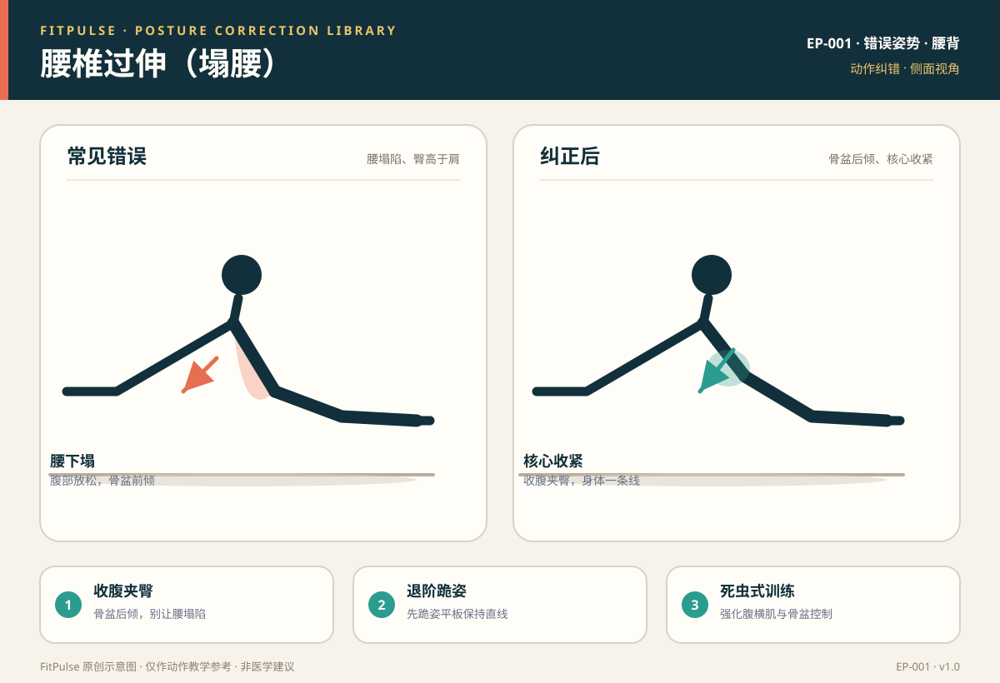

# 腰椎过伸（塌腰）

*图示：左为塌腰错误（腰下陷、臀高于肩），右为骨盆后倾、核心收紧的纠正姿势；仅作教学示意。*

## 一句话要点

“塌腰”是平板支撑、俯卧撑、硬拉等动作里腰椎过度前凸、骨盆前倾、腹部放松的代偿姿势；纠正的核心是收腹夹臀、骨盆后倾，让身体（或脊柱）保持中立，必要时退阶。

## 错误姿势长什么样

- 平板支撑/俯卧撑：腰部明显下陷，臀部高于肩，肚子往地面方向“掉”。
- 硬拉/臀桥顶端：过度挺腰、骨盆前倾，用腰往后顶。
- 从侧面看，腰椎前凸角度明显增大，身体不是一条直线。

## 为什么会发生

- **核心无力**：腹横肌、臀大肌不能维持骨盆稳定，腰椎被动前凸。
- **髋屈肌紧张**：久坐使髂腰肌、股直肌缩短，牵拉骨盆前倾。
- **臀肌未激活**：臀不发力，髋伸展时用腰代偿。
- **追求过大幅度**：为了“做得更深/更高”而牺牲中立位。

## 潜在风险

- 腰椎小关节与椎间盘后侧压力增大，诱发或加重下背痛。
- 长期以塌腰姿势训练，会让“腰发力”成为习惯，影响深蹲、硬拉等动作质量。
- 严重时伴随腰部紧张、酸胀，甚至向臀部、腿部放射的不适。

## 如何自查

- **侧面录像**：平板支撑时身体是否成一条直线，腰是否有明显下陷。
- **手感检查**：一手放在腰后，感受腰椎是否过度前凸、腹部是否放松。
- **酸痛位置**：练完若主要是腰酸而非目标肌群酸，提示可能塌腰代偿。

## 纠正方法

1. **收腹夹臀**：先做骨盆后倾（想象把肚脐往脊柱方向收、臀部轻夹），再进入支撑姿势。
2. **退阶**：平板支撑改跪姿平板；俯卧撑改上斜或跪姿，先保住中立位。
3. **强化核心**：死虫式（EX-006）、鸟狗式（EX-007）练习抗伸展稳定。
4. **拉伸髋屈肌**：弓步拉伸髂腰肌，减少骨盆前倾牵拉。
5. **缩小幅度**：硬拉、臀桥不追求过高，以脊柱中立为准。

## 关联动作

俯卧撑（EX-004）、前臂平板支撑（EX-005）、死虫式（EX-006）、鸟狗式（EX-007）。

## 何时需要就医（红旗信号）

出现以下情况应停止训练并就医：腰背剧烈疼痛、疼痛向臀部或腿放射、下肢麻木或无力、夜间痛、大小便功能异常。

## 常见问题

**Q：平板支撑腰塌一点有关系吗？**  
A：偶发的轻微塌腰风险较小，但长期塌腰会增加腰椎压力、养成错误习惯。建议退阶到跪姿平板，先保证身体一条直线。

**Q：臀桥是不是越高越好？**  
A：不是。臀桥的目标是臀发力、脊柱中立，过度顶高会让腰椎反弓。顶端身体成一条直线、臀部收紧即可。

**Q：怎么判断自己是不是塌腰？**  
A：最直接的方法是侧面录像或请人从侧面看：支撑时腰是否下陷、臀是否高于肩。也可以把手放腰后感受腰椎前凸是否明显增大。

## 知识出处

- [S3] ACE Exercise Library（平板支撑、俯卧撑常见错误）
- [S6] Neumann, Kinesiology of the Musculoskeletal System（腰椎与骨盆力线）
- [S7] NASM Essentials of Corrective Exercise Training（腰椎过伸代偿与纠正策略）
- [S8] McGill, Ultimate Back Fitness and Performance（腰椎中立与核心稳定）

完整书目与访问日期见 [SOURCES.md](../SOURCES.md)。

> 本条目由 FitPulse 团队整理，用于教学参考，不替代医生或线下教练的个体化评估。
