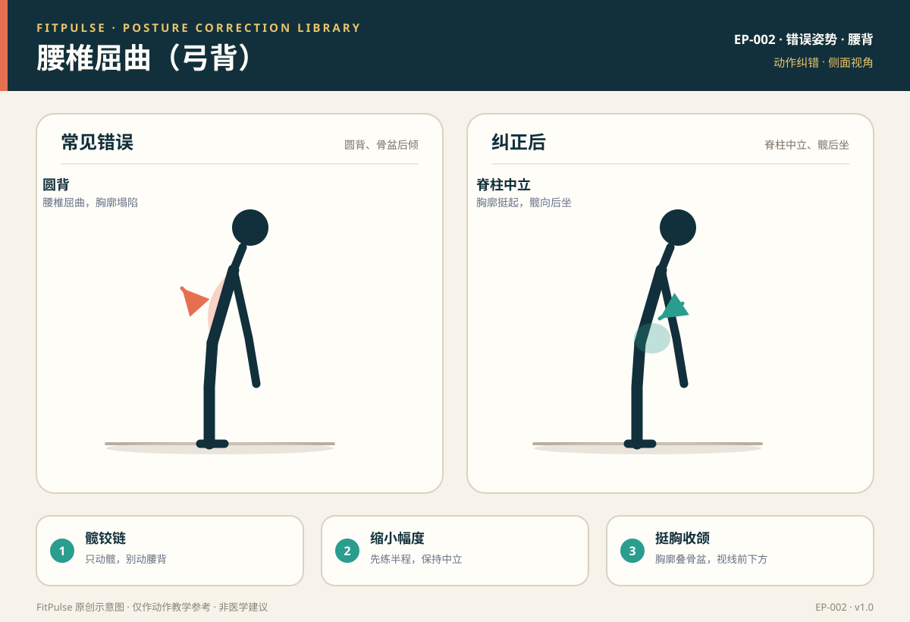

# 腰椎屈曲（弓背）

*图示：左为弓背错误（圆背、骨盆后倾），右为脊柱中立、髋后坐的纠正姿势；仅作教学示意。*

## 一句话要点

“弓背”是硬拉、划船、俯身等动作里腰椎屈曲、骨盆后倾、胸廓塌陷的代偿姿势；纠正的核心是学会髋铰链（只动髋、不动腰背），保持脊柱中立，必要时缩小幅度或减重。

## 错误姿势长什么样

- 硬拉/划船俯身时：后背圆起、肩向前塌、骨盆后倾，像“猫背”。
- 深蹲最低点时：腰椎屈曲、骨盆后倾，尾骨“卷”向地面。
- 从侧面看，脊柱失去中立，胸廓和骨盆不再对齐。

## 为什么会发生

- **腘绳肌紧张/髋活动不足**：髋屈不起来，就靠弯腰来“够”得更低。
- **不会髋铰链**：把“俯身”做成“弯腰”，分不清髋屈和脊柱屈。
- **重量过大**：超过控制能力时，下意识弓背“借力”。
- **核心未绷紧**：缺少腹压支撑，腰椎在负荷下屈曲。

## 潜在风险

- 腰椎屈曲下负重会增加椎间盘后侧压力，是下背痛和椎间盘问题的常见诱因。
- 长期弓背硬拉/划船，会让背部肌群和竖脊肌无法有效参与，动作收益下降。
- 可能伴随腰部牵拉感、僵硬，甚至向腿放射的不适。

## 如何自查

- **侧面录像**：俯身时后背是否圆起、胸廓是否塌陷。
- **动作习惯**：下放时是否靠“弯腰”而不是“髋向后坐”。
- **酸痛位置**：练完若主要是下背牵拉/疼痛而非臀腿或背部目标肌群，提示可能弓背。

## 纠正方法

1. **学髋铰链**：手扶髋，保持脊柱中立，只把髋向后推、上身随之俯下，感受腘绳肌和臀拉伸。
2. **挺胸收颌**：俯身时胸廓挺起、下巴微收，视线略向前下方。
3. **缩小幅度**：硬拉下放到大腿中段（不追求触地），先保住中立位。
4. **减重**：重量减到能全程保持脊柱中立，再逐步增加。
5. **核心绷紧**：发力前吸气建立腹压，保护腰椎。

## 关联动作

自重深蹲（EX-001）、哑铃单臂俯身划船（EX-008）、哑铃罗马尼亚硬拉（EX-009）。

## 何时需要就医（红旗信号）

出现以下情况应停止训练并就医：下背剧烈疼痛、疼痛向臀部或腿放射、下肢麻木或无力、夜间痛、大小便功能异常。

## 常见问题

**Q：硬拉一定要把哑铃放到地上吗？**  
A：不一定。新手应以“脊柱中立、髋铰链正确”为准，可以只下放到大腿中段或小腿附近；强行触地而弓背反而增加风险。

**Q：弓背和塌腰有什么区别？**  
A：弓背是腰椎屈曲、骨盆后倾（背圆起）；塌腰是腰椎过伸、骨盆前倾（腰反弓）。两者都是脊柱中立位丢失，纠正方向不同。

**Q：怎么判断自己是“弯腰”还是“髋铰链”？**  
A：髋铰链时骨盆和躯干一起围绕髋关节转动、背部保持平直，主要是臀腿后侧有牵拉感；弯腰则是脊柱本身弯曲。可以手扶髋感受“髋向后推”。

## 知识出处

- [S2] NSCA Essentials of Strength Training and Conditioning（硬拉/划船技术与脊柱中立）
- [S3] ACE Exercise Library（硬拉、俯身常见错误）
- [S6] Neumann, Kinesiology of the Musculoskeletal System（腰椎与髋关节力线）
- [S8] McGill, Ultimate Back Fitness and Performance（脊柱中立与腰椎负荷）

完整书目与访问日期见 [SOURCES.md](../SOURCES.md)。

> 本条目由 FitPulse 团队整理，用于教学参考，不替代医生或线下教练的个体化评估。
