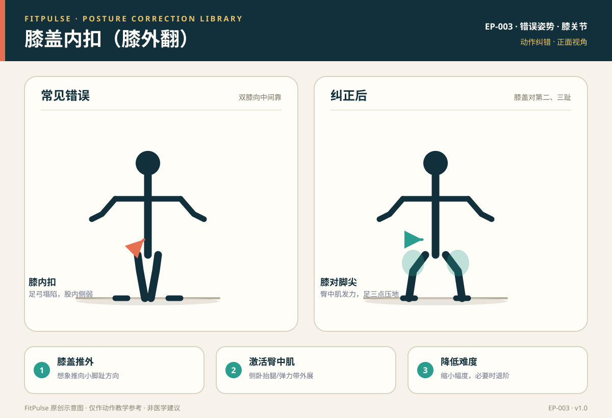

# 膝盖内扣（膝外翻）

*图示：左为深蹲膝盖内扣错误，右为膝盖对脚尖、足弓稳定的纠正姿势；仅作教学示意。*

## 一句话要点

“膝盖内扣”是深蹲、弓步、跳跃等动作里双膝向中间靠拢、足弓塌陷的代偿姿势；纠正的核心是让膝盖沿第二、三脚趾方向移动，激活臀中肌、稳定足弓，必要时降低难度。

## 错误姿势长什么样

- 深蹲/靠墙静蹲：下蹲或站起时两膝向中间靠，甚至互相触碰。
- 弓步/开合跳：落地或蹲下时膝盖向内塌，脚内侧塌陷。
- 从正面看，膝盖、髋、踝三点不在一条接近垂直的线上，膝盖明显内偏。

## 为什么会发生

- **臀中肌偏弱**：无法控制大腿外展与外旋，膝盖被动内收。
- **髋内收肌紧张**：内收肌过紧把大腿往内拉。
- **足弓塌陷**：扁平足或足底不稳，力线从脚向上传递时向内偏。
- **股内侧肌偏弱**：伸膝末端控制不足。

## 潜在风险

- 增加髌股关节压力，可能诱发髌骨周围疼痛（“跑步膝”样不适）。
- 跳跃落地时膝盖内扣，会加大前交叉韧带（ACL）等结构的应力。
- 长期内扣会固化错误力线，影响深蹲、弓步等动作质量。

## 如何自查

- **正面录像**：深蹲时从正面看，膝盖是否向中间靠。
- **镜子观察**：膝盖是否与第二、三脚趾同向。
- **触觉反馈**：在膝盖外侧轻套弹力带，感受是否被“往里带”。

## 纠正方法

1. **膝盖推外**：提示“膝盖推向小脚趾方向”，全程保持与脚尖同向。
2. **激活臀中肌**：侧卧抬腿、蚌式、弹力带侧走，训练前先做 1–2 组。
3. **稳定足弓**：全脚掌三点压地（大脚趾、小脚趾、脚跟），不要脚内侧塌陷。
4. **降低难度**：缩小下蹲深度、减少次数，必要时退阶到箱式深蹲。
5. **弹力带反馈**：在膝盖上方套轻弹力带，提供向外撑的触觉提示。

## 关联动作

自重深蹲（EX-001）、后撤弓步蹲（EX-003）、靠墙静蹲（EX-011）、开合跳（EX-012）。

## 何时需要就医（红旗信号）

出现以下情况应停止训练并就医：膝关节明显肿胀、关节锁住、打软腿、剧烈疼痛或活动受限持续不缓解。

## 常见问题

**Q：膝盖内扣会伤膝盖吗？**  
A：长期或在高负荷、跳跃落地时内扣，会增加膝关节和韧带应力，是常见风险因素之一。即使无痛，也建议纠正力线，尤其在做负重或跳跃动作时。

**Q：扁平足一定会膝盖内扣吗？**  
A：不一定，但扁平足/足弓塌陷是膝盖内扣的常见诱因。可以通过全脚掌三点压地、足弓激活和合适的鞋垫来改善，必要时咨询康复师。

**Q：弹力带套膝盖上练深蹲有用吗？**  
A：有用。轻弹力带能提供向外撑的触觉提示，帮助你主动用臀中肌维持膝盖外展，但不要用太紧的弹力带改变动作本身。

## 知识出处

- [S3] ACE Exercise Library（深蹲、弓步常见错误与臀中肌激活）
- [S6] Neumann, Kinesiology of the Musculoskeletal System（膝、髋、踝力线与臀中肌功能）
- [S7] NASM Essentials of Corrective Exercise Training（膝外翻代偿与纠正策略）

完整书目与访问日期见 [SOURCES.md](../SOURCES.md)。

> 本条目由 FitPulse 团队整理，用于教学参考，不替代医生或线下教练的个体化评估。
