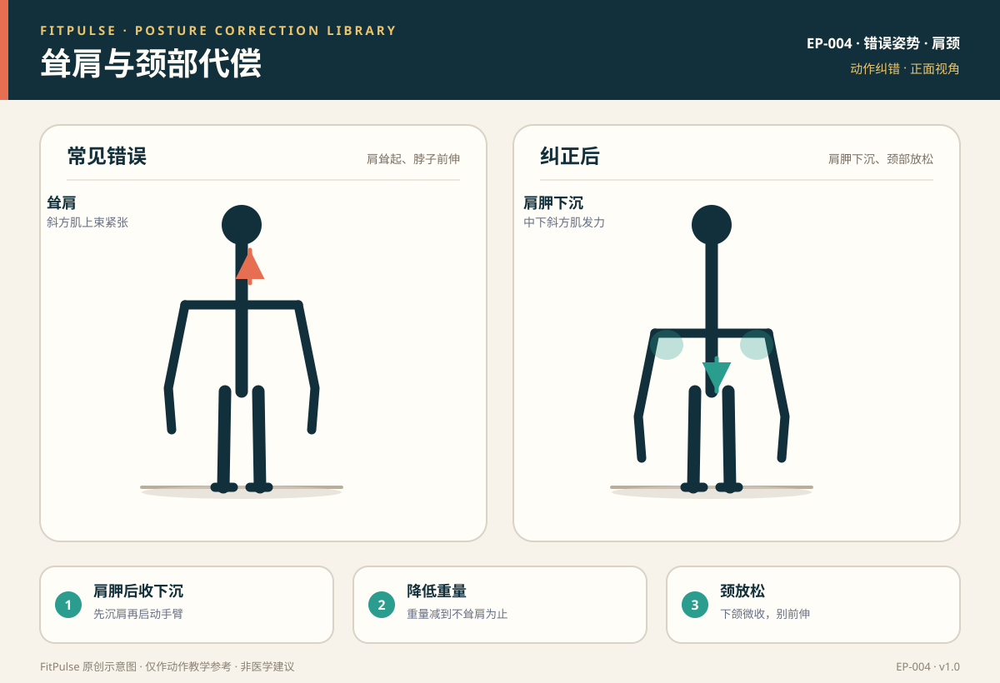

# 耸肩与颈部代偿

*图示：左为耸肩、颈前伸错误，右为肩胛下沉、颈放松的纠正姿势；仅作教学示意。*

## 一句话要点

“耸肩”是划船、推举、俯卧撑等动作里斜方肌上束过度紧张、肩胛上提、颈部代偿的错误姿势；纠正的核心是先做肩胛后收下沉，重量减到能不耸肩为止，并保持颈部中立。

## 错误姿势长什么样

- 划船/推举/俯卧撑：肩膀往耳朵方向耸起，脖子显得“短”，下颌前伸。
- 斜方肌上束明显紧张隆起，动作过程中肩胛骨上提。
- 颈部、上斜方肌长期酸胀，甚至牵涉到头部。

## 为什么会发生

- **重量过大**：超过控制能力时，身体下意识耸肩“借力”。
- **斜方肌上束过强、中下束偏弱**：肩胛下沉与后收的稳定肌不足。
- **胸小肌紧张/圆肩**：肩胛位置不良，上斜方肌代偿。
- **习惯性颈前伸**：看屏幕、伏案姿势让颈部代偿。

## 潜在风险

- 颈肩部肌肉紧张、酸痛，甚至诱发紧张性头痛。
- 肩关节在不良位置受力，增加肩峰撞击风险。
- 长期耸肩会削弱目标肌群（背阔肌、三角肌）的训练效果。

## 如何自查

- **镜子/录像**：动作中肩膀是否上耸、脖子是否前伸。
- **手感检查**：手放斜方肌上束，感受是否持续紧绷。
- **酸痛位置**：练完若主要是脖子和上斜方肌酸，提示耸肩代偿。

## 纠正方法

1. **肩胛后收下沉**：启动动作前先“把肩胛往后、往下放”，再屈肘或推起。
2. **降低重量**：减到全程不耸肩的重量，再逐步增加。
3. **颈中立**：下颌微收，视线平视或略向下，别往前伸。
4. **强化中下斜方肌**：弹力带面拉、墙壁天使、肩胛后缩练习。
5. **放松上斜方肌/胸小肌**：适当拉伸，改善圆肩体态。

## 关联动作

俯卧撑（EX-004）、哑铃单臂俯身划船（EX-008）、哑铃肩上推举（EX-010）。

## 何时需要就医（红旗信号）

出现以下情况应停止训练并就医：颈部或肩部剧烈疼痛、手臂麻木或无力、疼痛向手臂放射、伴有头晕。

## 常见问题

**Q：推举时总耸肩，是重量太重吗？**  
A：很可能是原因之一。先减重，推举前主动把肩胛向下沉；若减重后仍耸肩，先练肩胛下沉与面拉等控制动作。

**Q：练完脖子酸正常吗？**  
A：如果主要是斜方肌上束和脖子酸，通常提示耸肩或颈前伸代偿，建议纠正。正常的肩背训练应以目标肌群酸胀为主。

**Q：如何区分正常的肩部发力感和耸肩？**  
A：正常发力时肩胛保持稳定、颈部放松，三角肌或背部目标肌群有收紧感；耸肩时肩膀明显上提、脖子变短、上斜方肌先酸。

## 知识出处

- [S3] ACE Exercise Library（划船、推举、俯卧撑常见错误）
- [S5] Mayo Clinic, Weight training: Do's and don'ts of proper technique（避免借力与保持放松）
- [S6] Neumann, Kinesiology of the Musculoskeletal System（肩胛带与斜方肌功能解剖）
- [S7] NASM Essentials of Corrective Exercise Training（耸肩代偿与纠正策略）

完整书目与访问日期见 [SOURCES.md](../SOURCES.md)。

> 本条目由 FitPulse 团队整理，用于教学参考，不替代医生或线下教练的个体化评估。
