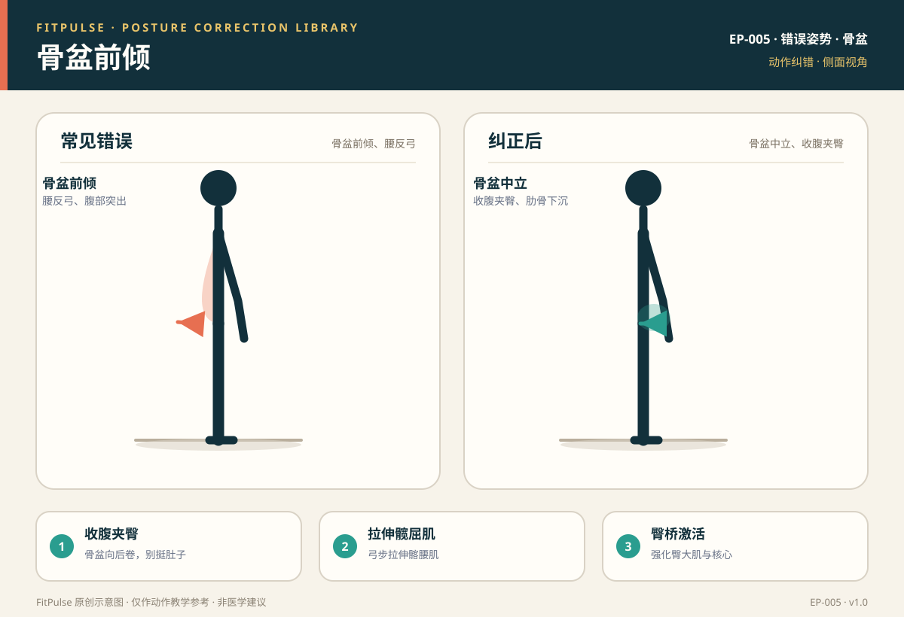

# 骨盆前倾

*图示：左为骨盆前倾、腰反弓错误，右为骨盆中立、收腹夹臀的纠正姿势；仅作教学示意。*

## 一句话要点

“骨盆前倾”是站姿或平板支撑等动作里骨盆向前旋转、腰椎前凸增加、腹部突出的体态问题；纠正的核心是收腹夹臀、把骨盆向后卷至中立，并配合髋屈肌拉伸与臀腹强化。

## 错误姿势长什么样

- 站姿：腰部反弓、肚子前凸，臀部后翘（俗称“假翘臀”）。
- 平板支撑：腰下陷，与“塌腰”表现相似，本质是骨盆前倾。
- 从侧面看，髂前上棘（骨盆前上缘）明显向前下倾斜，腰椎前凸增大。

## 为什么会发生

- **髋屈肌紧张**：久坐使髂腰肌、股直肌缩短，向前下拉骨盆。
- **臀大肌、腹肌偏弱**：无法把骨盆拉回中立。
- **竖脊肌过紧**：腰椎长期处于过伸状态。
- **习惯性挺腰**：站立时习惯“挺肚子”以显得挺拔。

## 潜在风险

- 腰椎长期过伸，增加下背痛和腰椎关节压力。
- 髋关节前侧受压，可能诱发髋前侧不适。
- 影响深蹲、硬拉的中立位，增加动作代偿。

## 如何自查

- **侧面镜子/照片**：站立放松时腰部是否过度反弓、肚子是否前凸。
- **骨盆卷动**：仰卧屈膝做骨盆后倾（把腰压向地面），感受骨盆前倾—中立—后倾的区别。
- **平板支撑**：是否出现塌腰、臀高于肩。

## 纠正方法

1. **收腹夹臀**：站立或支撑时主动“骨盆向后卷”，让耻骨向上、尾骨向下，回到中立。
2. **拉伸髋屈肌**：弓步拉伸髂腰肌、股直肌，缓解前拉。
3. **强化臀腹**：臀桥（EX-002）、死虫式（EX-006）训练骨盆后倾与稳定。
4. **站姿意识**：站立时膝盖微松、核心轻收，避免过度挺腰。

## 关联动作

自重深蹲（EX-001）、臀桥（EX-002）、前臂平板支撑（EX-005）。

## 何时需要就医（红旗信号）

出现以下情况应停止训练并就医：持续下背痛、疼痛向臀腿放射、下肢麻木或无力、夜间痛。

## 常见问题

**Q：骨盆前倾和“翘臀”怎么区分？**  
A：真正的翘臀是臀部肌肉发达且骨盆中立；骨盆前倾是腰椎反弓、肚子前凸的体态代偿，长期反而增加腰痛风险。

**Q：久坐导致的骨盆前倾能纠正吗？**  
A：可以。核心是“拉伸紧张的髋屈肌 + 强化偏弱的臀腹”，并养成收腹夹臀、避免过度挺腰的站姿习惯，需要持续练习。

**Q：平板支撑时骨盆前倾怎么办？**  
A：进入支撑前先做骨盆后倾（收腹夹臀），再保持身体一条直线；若仍塌腰，退阶到跪姿平板。

## 知识出处

- [S3] ACE Exercise Library（平板支撑、臀桥常见错误）
- [S6] Neumann, Kinesiology of the Musculoskeletal System（骨盆与腰椎力线）
- [S7] NASM Essentials of Corrective Exercise Training（骨盆前倾代偿与纠正策略）
- [S8] McGill, Ultimate Back Fitness and Performance（骨盆中立与腰椎稳定）

完整书目与访问日期见 [SOURCES.md](../SOURCES.md)。

> 本条目由 FitPulse 团队整理，用于教学参考，不替代医生或线下教练的个体化评估。
