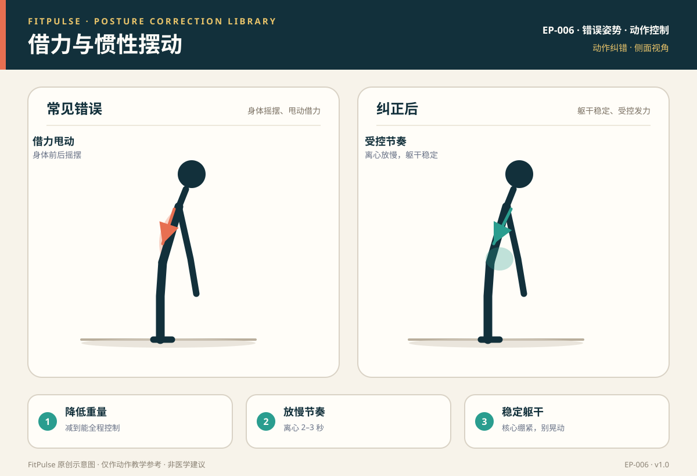

# 借力与惯性摆动

*图示：左为划船借力甩动、身体摇摆错误，右为躯干稳定、受控拉动的纠正姿势；仅作教学示意。*

## 一句话要点

“借力”是用身体摇摆、惯性甩动来代替目标肌群发力的动作失控；纠正的核心是降低重量、放慢节奏，让躯干稳定、目标肌群全程受控地完成动作。

## 错误姿势长什么样

- 划船/推举：用腰部前后甩、身体上下起伏把重量“荡”起来。
- 硬拉/深蹲：起身靠快速弹起或惯性反弹，而不是肌肉控制。
- 开合跳等：落地失去控制、节奏忽快忽慢。
- 动作速度过快，离心阶段“掉”下去而不是“放”下去。

## 为什么会发生

- **重量过大**：超过目标肌群的控制能力，只能靠惯性完成。
- **动作不熟练**：还没建立稳定的动作模式就追求次数。
- **疲劳**：力竭后为完成次数而借力代偿。
- **缺乏节奏意识**：只关注“做几下”，不关注“怎么做”。

## 潜在风险

- 惯性冲击会增加关节和韧带的瞬时负荷，容易拉伤。
- 腰部摇摆、反弹会诱发腰椎代偿和肌肉拉伤。
- 目标肌群刺激下降，训练效果打折，还固化错误模式。

## 如何自查

- **录像**：动作中躯干是否前后摇摆、是否靠惯性“荡”起重量。
- **节奏检查**：离心阶段是否能在 2–3 秒内受控下放。
- **疲劳判断**：是否做到最后几个动作明显变形、只能靠甩动完成。

## 纠正方法

1. **降低重量**：减到能全程受控、无摇摆的重量。
2. **放慢节奏**：离心阶段 2–3 秒，向心 1–2 秒，顶端可短暂停顿。
3. **稳定躯干**：核心绷紧、肩胛稳定，把动作锁定在目标关节。
4. **减少次数**：宁可少做几次高质量，也不做一长串借力。
5. **力竭即停**：出现明显代偿就结束该组，避免固化错误模式。

## 关联动作

哑铃单臂俯身划船（EX-008）、哑铃肩上推举（EX-010）、开合跳（EX-012）。

## 何时需要就医（红旗信号）

出现以下情况应停止训练并就医：关节或肌肉的急性拉伤感、明显肿胀、活动受限、疼痛持续不缓解。

## 常见问题

**Q：借力一点都不能有吗？**  
A：作为教学建议，新手阶段应尽量保持受控，避免靠惯性甩动。高级训练者有时会用“受控借力”冲击大重量，但那是建立在技术成熟基础上的进阶技巧，不建议新手模仿。

**Q：怎么判断重量是不是太重？**  
A：如果你在最后几次必须靠身体摇摆、腰部甩动才能完成，或者离心阶段完全失控，说明重量偏重。减到能全程受控的重量。

**Q：训练节奏放慢有什么好处？**  
A：放慢离心能延长肌肉受力时间、提升控制力，并降低惯性冲击，对建立动作模式和预防受伤都有帮助。

## 知识出处

- [S2] NSCA Essentials of Strength Training and Conditioning（动作速度与受控技术）
- [S5] Mayo Clinic, Weight training: Do's and don'ts of proper technique（受控动作、避免借力）
- [S7] NASM Essentials of Corrective Exercise Training（动作控制与代偿）

完整书目与访问日期见 [SOURCES.md](../SOURCES.md)。

> 本条目由 FitPulse 团队整理，用于教学参考，不替代医生或线下教练的个体化评估。
