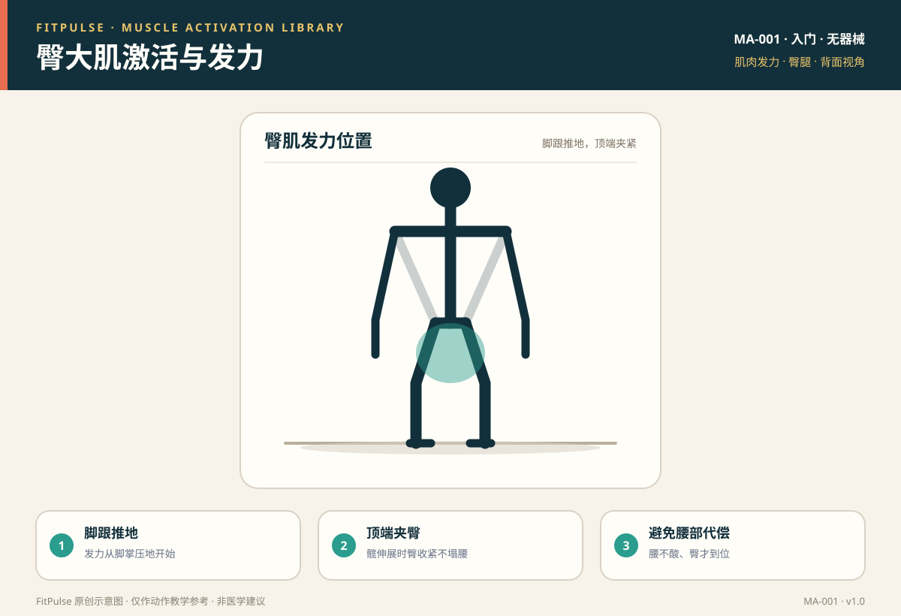

# 臀大肌激活与发力

*图示：背面视角，标注臀大肌发力位置；仅作教学示意。*

## 一句话要点

臀肌发力是“髋伸展 + 顶端收紧”的感觉，先学会在臀桥、蚌式这类低负荷动作里“唤醒”臀肌，再迁移到深蹲和硬拉；腰部发酸通常是臀没发力、腰椎在代偿。

## 目标肌群与发力位置

- **主要**：臀大肌（髋伸展、髋外旋的主力）。
- **协同**：臀中肌（单腿站立时稳定骨盆）、腘绳肌（髋伸展协同）。
- **发力位置**：动作顶端臀部收紧，坐骨处应有“夹紧”感；发力起点在脚跟压地，而不是靠腰往后仰。

## 为什么要先学发力感

臀大肌是很多人“沉睡”的肌群：久坐让髋屈肌紧张、臀肌长期不参与，深蹲和硬拉时容易变成腰部或大腿前侧主导。先做低负荷激活，能建立“臀—腿—核心”的发力顺序，降低腰椎代偿风险，也为后续负重动作打好基础。

## 激活准备（唤醒）

| 动作 | 做法 | 目标 |
|---|---|---|
| 臀桥 | 仰卧屈膝，脚跟推地抬髋，顶端夹臀 2 秒 | 臀大肌基础激活 |
| 蚌式 | 侧卧屈膝，双膝并拢，上方膝盖像蚌壳般打开 | 臀中肌激活 |
| 侧卧髋外展 | 侧卧，上方腿伸直抬起约 30° | 臀中肌激活 |
| 弹力带侧走 | 膝盖微屈，弹力带套膝上，横向小步走 | 臀中肌 + 骨盆稳定 |

## 发力技巧与提示语

- **脚跟推地**：想象用脚跟把地面“推开”，而不是踮脚尖或只靠大腿前侧。
- **顶端夹臀**：髋完全伸展时臀部主动收紧 1–2 秒，不要用腰往后顶。
- **膝盖微外旋**：让膝盖有“向外旋开”的轻微意图，帮助臀中肌参与，避免内扣。
- **动作幅度**：以臀有发力感为准，不必为了“更高”而反弓腰。

## 常见的“发力错误感”（代偿信号）

| 错误感 | 说明 | 处理 |
|---|---|---|
| 腰部酸 | 腰椎代偿，臀没发力 | 缩小幅度，收腹夹臀，先做臀桥 |
| 大腿前侧主导 | 股四头肌代偿，重心偏前 | 强调脚跟推地，髋向后坐 |
| 大腿后侧过紧 | 腘绳肌主导 | 减小幅度，加臀桥顶端停顿 |
| 小腿酸 | 重心跑到前脚掌 | 全脚掌三点压地，脚跟踩稳 |

## 自测方法

做 10 次臀桥，若顶端能清楚感到臀部收紧、而腰和大腿前侧不酸，说明发力基本正确；若腰酸明显，回到“降阶”的臀桥，先只练收紧感。

## 关联动作

本条目作为发力基础，服务于：自重深蹲（EX-001）、臀桥（EX-002）、后撤弓步蹲（EX-003）、哑铃罗马尼亚硬拉（EX-009）。

## 呼吸配合

抬髋/站起（向心）时呼气并收紧臀肌，下放/下蹲（离心）时吸气；不要在顶端长时间憋气。

## 安全提示

- 收紧时若出现腰、髋尖锐疼痛或放射痛，停止并就医。
- 弹力带训练要固定稳，避免滑脱抽打。
- 本条目是教学信息，不构成医疗建议。

## 常见问题

**Q：练臀一定要“夹到很紧”吗？**  
A：顶端主动收紧有助于建立发力感，但不需要刻意夹到腰部代偿或骨盆过度后倾。目标是“臀发力、腰放松”，而不是追求最大程度的收缩。

**Q：为什么我练完臀没感觉，腰却酸？**  
A：常见原因是臀肌尚未被唤醒、髋屈肌紧张或动作幅度过大导致腰椎代偿。先做臀桥、蚌式等激活，缩小幅度，强调脚跟推地和收腹。

**Q：臀肌激活要每天做吗？**  
A：激活练习（低负荷）可以作为训练前热身，每次 1–2 组、每组 10–15 次即可；不需要单独当作高强度训练每天练到力竭。

## 知识出处

- [S3] ACE Exercise Library（臀桥、蚌式等激活动作要点）
- [S4] ExRx Exercise Directory（髋伸展肌群与动作分类）
- [S6] Neumann, Kinesiology of the Musculoskeletal System（臀大肌/臀中肌功能解剖）

完整书目与访问日期见 [SOURCES.md](../SOURCES.md)。

> 本条目由 FitPulse 团队整理，用于教学参考，不替代医生或线下教练的个体化评估。
