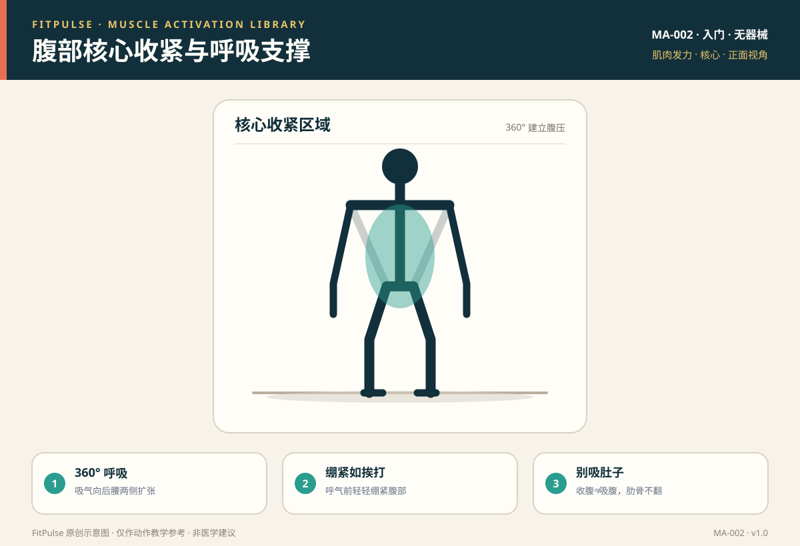

# 腹部核心收紧与呼吸支撑

*图示：正面视角，标注核心收紧区域；仅作教学示意。*

## 一句话要点

核心收紧是“像要被轻轻打一下肚子那样”把腹壁 360° 绷紧，用呼吸建立腹压，而不是单纯“吸肚子”；这是深蹲、硬拉和所有负重的保护性基础。

## 目标肌群与发力位置

- **主要**：腹横肌（像“天然腰带”包裹腹部）、腹内斜肌、腹外斜肌、腹直肌。
- **深层稳定**：膈肌、盆底肌、多裂肌共同构成“核心罐体”，维持腹腔压力与腰椎稳定。
- **发力位置**：腹部前侧、两侧和后腰都要有向外的绷紧感，而非只有肚脐内缩。

## 为什么要先学发力感

核心的功能首先是“稳定躯干、传递力”，其次才是“看得见的腹肌”。如果不会建立腹压，负重深蹲、硬拉时腰椎就失去保护，容易出现塌腰、弓背等代偿。先学会“绷紧”，比追求卷腹次数更基础。

## 激活准备（唤醒）

| 动作 | 做法 | 目标 |
|---|---|---|
| 仰卧 360° 呼吸 | 仰卧屈膝，吸气到腹部前、侧、后腰都扩张 | 学会用膈肌呼吸 |
| 死虫式 | 仰卧，对侧手脚缓慢伸展，腰贴地 | 抗伸展稳定 |
| 鸟狗式 | 四点支撑，对侧手脚伸展，骨盆不晃动 | 抗旋转稳定 |
| 前臂平板支撑 | 保持身体一条线，腹部绷紧 | 综合稳定耐力 |

## 发力技巧与提示语

- **360° 呼吸**：吸气时想象腹部像气球向四周扩张，包括后腰；不要只挺肚子。
- **绷紧如挨打**：呼气前把腹壁轻轻绷紧，像防备肚子被碰一下，这是“brace”，不是“吸肚子”。
- **瓦式呼吸（负重时）**：负重前深吸一口气并屏住建立腹压，完成最费力段后再缓慢呼气；轻负荷/徒手时用“下蹲吸气、站起呼气”即可。
- **肋骨下沉**：不要让肋骨外翻，保持胸廓叠在骨盆上方。

## 常见的“发力错误感”（代偿信号）

| 错误感 | 说明 | 处理 |
|---|---|---|
| 憋气到头晕 | 长时间用力屏气 | 只在最费力段短暂屏气，其余自然呼吸 |
| 只吸肚子 | 腹部内缩，反而失去支撑 | 改成“向外绷紧”，练习 360° 呼吸 |
| 肋骨外翻 | 吸气只挺上腹，腰反弓 | 肋骨下沉，收腹，减小动作幅度 |
| 腰酸 | 靠腰部代偿稳定 | 退阶到死虫式/跪姿平板，重新建立腹压 |

## 自测方法

前臂平板支撑时，若能在不塌腰、不撅臀的前提下保持 20–30 秒且能正常呼吸说话，说明核心支撑基本到位；若 10 秒就腰塌，先退阶到跪姿平板。

## 关联动作

本条目作为稳定基础，服务于：自重深蹲（EX-001）、前臂平板支撑（EX-005）、死虫式（EX-006）、鸟狗式（EX-007）、哑铃罗马尼亚硬拉（EX-009）。

## 呼吸配合

- **徒手/轻负荷**：下蹲/下放吸气，站起/发力呼气。
- **负重**：发力前吸气并绷紧（瓦式呼吸），完成最费力段后缓慢呼气。
- **等长动作（平板）**：保持自然呼吸，不憋气。

## 安全提示

- 有未控制的高血压、心血管疾病或青光眼等情况，避免长时间用力屏气（瓦式呼吸），先咨询医生。
- 出现胸痛、明显头晕、眼前发黑时停止。
- 本条目是教学信息，不构成医疗建议。

## 常见问题

**Q：核心收紧就是“吸肚子”吗？**  
A：不是。吸肚子（hollowing）只让腹部内缩，反而削弱支撑；核心收紧（bracing）是让腹壁 360° 向外绷紧，像建立一圈“天然护腰”。

**Q：训练时到底要不要憋气？**  
A：徒手和轻负荷不需要刻意憋气，保持“发力呼气、还原吸气”即可。只有较大负重、需要稳定腰椎时才使用瓦式呼吸（短暂屏气建立腹压），有心血管问题者应先咨询医生。

**Q：为什么我练腹肌，腰却越来越酸？**  
A：常见原因是卷腹、抬腿时腰椎代偿。先退阶到死虫式、鸟狗式等低负荷稳定动作，确保腰部贴地、核心先绷紧，再逐步增加难度。

## 知识出处

- [S1] ACSM's Guidelines for Exercise Testing and Prescription（运动筛查与呼吸原则）
- [S2] NSCA Essentials of Strength Training and Conditioning（瓦式呼吸与负重稳定）
- [S5] Mayo Clinic, Weight training: Do's and don'ts of proper technique（避免憋气）
- [S6] Neumann, Kinesiology of the Musculoskeletal System（核心肌群功能解剖）
- [S8] McGill, Ultimate Back Fitness and Performance（核心稳定与腰椎保护）

完整书目与访问日期见 [SOURCES.md](../SOURCES.md)。

> 本条目由 FitPulse 团队整理，用于教学参考，不替代医生或线下教练的个体化评估。
