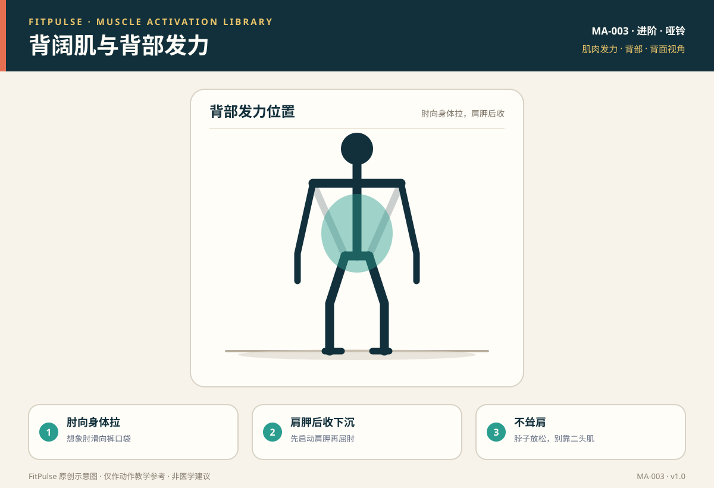

# 背阔肌与背部发力

*图示：背面视角，标注背阔肌发力位置；仅作教学示意。*

## 一句话要点

背部发力是“手肘向身体、肩胛骨后收下沉”的感觉，先让肩胛启动、再屈肘，把注意力放在背阔肌和肩胛之间，而不是靠肱二头肌和耸肩把重量拉起来。

## 目标肌群与发力位置

- **主要**：背阔肌（肩伸展、内收）、菱形肌、中下斜方肌（肩胛后收与下沉）。
- **协同**：肱二头肌、三角肌后束、前臂肌群。
- **发力位置**：拉动时腋下后侧（背阔肌）和两肩胛骨之间应有收紧感，而不是前臂和上斜方肌先酸。

## 为什么要先学发力感

背阔肌是“看不见的肌群”，新手很容易用肱二头肌和斜方肌上束代偿，导致练背变成“练手臂 + 耸肩”。先做轻负荷的肩胛后收和直臂下压，能建立“背先发力”的顺序，提升划船效果并保护肩颈。

## 激活准备（唤醒）

| 动作 | 做法 | 目标 |
|---|---|---|
| 肩胛后收 | 坐姿或俯身，肩胛骨向后夹、向下沉，保持 2 秒 | 菱形肌、中下斜方肌 |
| 弹力带直臂下压 | 直臂把弹力带从头顶拉向大腿两侧 | 背阔肌 |
| 无负重划船 | 空手模拟划船，先夹肩胛再屈肘 | 发力顺序 |

## 发力技巧与提示语

- **肘向身体拉**：想象手肘滑向“裤口袋”方向，而不是把哑铃直着向上提。
- **先启动肩胛**：先让肩胛后收下沉，再屈肘拉动，像“用肘子带”。
- **不耸肩**：脖子放松、斜方肌上束不代偿；重量减到能不耸肩为止。
- **顶点停顿**：拉到末端时两肩胛相夹 1 秒，再受控下放。

## 常见的“发力错误感”（代偿信号）

| 错误感 | 说明 | 处理 |
|---|---|---|
| 肱二头肌/前臂先酸 | 手臂主导 | 减重，先练肩胛后收，想象肘带动 |
| 耸肩、脖子酸 | 斜方肌上束代偿 | 肩胛下沉，减重，颈部放松 |
| 圆肩含胸 | 肩胛没有后收 | 练肩胛后收，挺胸，缩小幅度 |
| 腰部酸 | 俯身姿势不稳、借力 | 单手支撑稳定，核心绷紧，减小重量 |

## 自测方法

做轻重量单臂划船 10 次，若拉动时背阔肌和肩胛之间有明显收紧感、而前臂和脖子不酸，说明发力基本正确；若手臂先力竭，先做无负重的肩胛后收练习。

## 关联动作

本条目直接服务于：哑铃单臂俯身划船（EX-008）。

## 呼吸配合

拉动（向心）时呼气，下放（离心）时吸气；俯身支撑时核心保持轻微绷紧，避免憋气。

## 安全提示

- 使用稳固的椅子或训练凳做单臂支撑，避免椅子滑动。
- 拉动时若出现肩关节尖锐痛、手臂麻木或颈部放射痛，停止并就医。
- 本条目是教学信息，不构成医疗建议。

## 常见问题

**Q：为什么我练划船总是手臂先没力？**  
A：通常是肱二头肌代偿、背部没先启动。先减重，练习“先夹肩胛再屈肘”的顺序，并想象用肘子把重量拉向身体，注意力放在背阔肌和肩胛之间。

**Q：划船时可以耸肩吗？**  
A：不建议。耸肩会让斜方肌上束代偿，减少背部刺激，还容易造成颈肩紧张。先让肩胛后收下沉，重量以不耸肩为准。

**Q：背阔肌发力感不明显怎么办？**  
A：可以先用弹力带直臂下压、空手划船等轻负荷动作“唤醒”，并放慢动作节奏、在顶端停顿，逐步找到背阔肌的收紧感。

## 知识出处

- [S2] NSCA Essentials of Strength Training and Conditioning（划船动作技术与渐进原则）
- [S3] ACE Exercise Library（划船执行要点与常见错误）
- [S4] ExRx Exercise Directory（水平拉动作模式与肌群参与）
- [S6] Neumann, Kinesiology of the Musculoskeletal System（背阔肌、肩胛肌群功能解剖）

完整书目与访问日期见 [SOURCES.md](../SOURCES.md)。

> 本条目由 FitPulse 团队整理，用于教学参考，不替代医生或线下教练的个体化评估。
