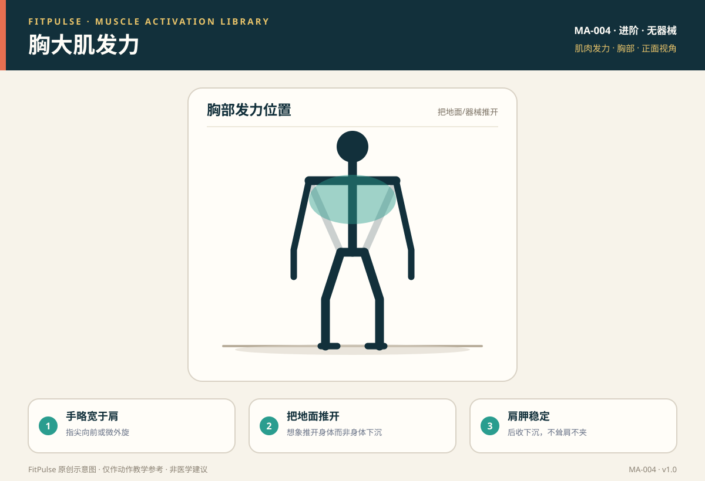

# 胸大肌发力

*图示：正面视角，标注胸大肌发力位置；仅作教学示意。*

## 一句话要点

胸部发力是“把地面或器械推开”的感觉，双手略宽于肩、肩胛骨保持后收下沉；关键是让胸肌承担推力，而不是耸肩、塌腰或只靠肱三头肌。

## 目标肌群与发力位置

- **主要**：胸大肌（肩水平内收、肩屈曲推力的主力）。
- **协同**：肱三头肌、三角肌前束、前锯肌（稳定肩胛）。
- **发力位置**：向下和推起过程中，胸前两侧应有收紧和牵拉感；顶端有轻微挤压感。

## 为什么要先学发力感

俯卧撑是居家推类动作的基础，但新手常因肩胛控制不足而耸肩、塌腰，把压力转移到肩和腰。先在上斜（手撑高处）和跪姿退阶中找到“胸发力、肩胛稳”的顺序，再逐步到标准俯卧撑，能有效保护肩颈和腰椎。

## 激活准备（唤醒）

| 动作 | 做法 | 目标 |
|---|---|---|
| 上斜俯卧撑 | 手撑桌面或床沿，身体成直线下推 | 低负荷胸部发力 |
| 跪姿俯卧撑 | 膝盖着地，保持躯干直线 | 退阶胸部发力 |
| 弹力带夹胸 | 双手持弹力带，胸前水平内收 | 胸大肌收缩感 |

## 发力技巧与提示语

- **手略宽于肩**：手掌与胸齐平，指尖向前或微外旋；过宽易伤肩，过窄偏三头肌。
- **把地面推开**：想象把身体“推离”地面，而不是让身体“掉下去”再撑起。
- **肩胛后收下沉**：下放时肩胛自然回收，推起时保持稳定，不耸肩、不夹死。
- **身体一条线**：核心绷紧、夹臀，头和脚跟保持直线，不塌腰、不撅臀。

## 常见的“发力错误感”（代偿信号）

| 错误感 | 说明 | 处理 |
|---|---|---|
| 肩前侧痛 | 耸肩或肩胛前伸 | 肩胛后收下沉，减重做上斜/跪姿 |
| 肱三头肌先酸 | 手过窄或肘过度外张 | 手略宽于肩，肘与躯干约 45° |
| 腰酸 | 塌腰、核心放松 | 收腹夹臀，退阶到跪姿/上斜 |
| 脖子酸 | 头前伸、看地面过远 | 颈部中立，视线略向前下方 |

## 自测方法

做跪姿俯卧撑 8–10 次，若胸前有收紧感、肩和腰不痛，说明发力基本正确；若肩前侧或腰先不适，退阶到上斜俯卧撑，先练肩胛稳定。

## 关联动作

本条目直接服务于：俯卧撑（含跪姿退阶）（EX-004）。

## 呼吸配合

下放（离心）时吸气，推起（向心）时呼气；全程核心轻收，避免憋气。

## 安全提示

- 手腕有旧伤者可用俯卧撑把手或握拳（拳面撑地）减少腕关节压力。
- 推起时若出现肩关节尖锐痛、手臂麻木或胸痛，停止并就医。
- 本条目是教学信息，不构成医疗建议。

## 常见问题

**Q：俯卧撑手放多宽合适？**  
A：一般略宽于肩，手掌与胸部大致齐平。过宽会增加肩关节压力，过窄则更多用到肱三头肌。以“胸有发力感、肩不痛”为准。

**Q：为什么我做俯卧撑肩膀先疼？**  
A：常见原因是耸肩、肩胛前伸或手放得过宽。先退阶到上斜或跪姿俯卧撑，保持肩胛后收下沉，让胸肌承担主要推力。

**Q：俯卧撑手肘要贴身体还是张开？**  
A：手肘与躯干约呈 45° 是多数人的舒适区间，既不夹死也不过度外展，能兼顾胸肌刺激和肩关节安全。

## 知识出处

- [S3] ACE Exercise Library（俯卧撑执行要点与常见错误）
- [S4] ExRx Exercise Directory（水平推动作模式与肌群参与）
- [S6] Neumann, Kinesiology of the Musculoskeletal System（胸大肌功能解剖）

完整书目与访问日期见 [SOURCES.md](../SOURCES.md)。

> 本条目由 FitPulse 团队整理，用于教学参考，不替代医生或线下教练的个体化评估。
