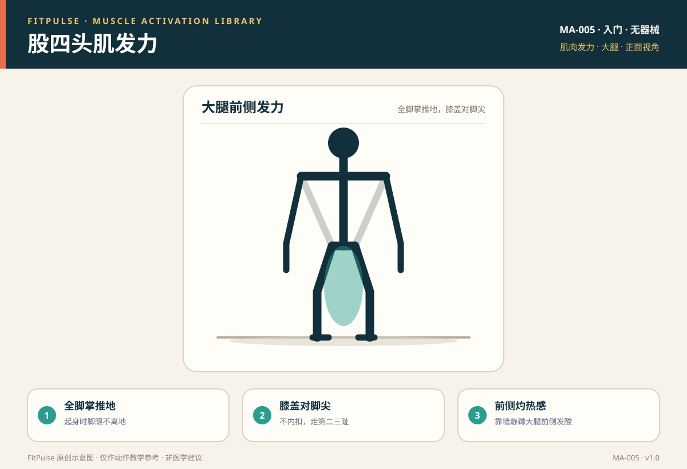

# 股四头肌发力

*图示：正面视角，标注大腿前侧（股四头肌）发力位置；仅作教学示意。*

## 一句话要点

股四头肌发力是“膝盖伸直 + 全脚掌推地”的感觉，深蹲站起时大腿前侧与臀部共同发力；关键是膝盖沿脚尖方向、脚跟不离地，而不是膝盖内扣或只靠脚尖蹬起。

## 目标肌群与发力位置

- **主要**：股四头肌（股直肌、股外侧肌、股内侧肌、股中间肌，负责伸膝；股直肌还参与屈髋）。
- **协同**：臀大肌、腘绳肌、内收肌群。
- **发力位置**：站起和伸膝时大腿前侧应有收紧和酸胀感；靠墙静蹲时大腿前侧有明显“灼热感”是正常的。

## 为什么要先学发力感

深蹲是下肢训练的基础，但新手常因股内侧肌（靠近膝盖内侧的那束）偏弱、臀中肌不足而出现膝盖内扣，把压力集中到膝关节。先学会“膝盖对脚尖、全脚掌推地”，能让股四头肌均衡发力，保护膝关节。

## 激活准备（唤醒）

| 动作 | 做法 | 目标 |
|---|---|---|
| 靠墙静蹲 | 背靠墙，屈膝约 90°，保持 20–45 秒 | 股四头肌等长激活 |
| 坐姿伸膝 | 坐姿，单腿缓慢伸直并停顿 | 股四头肌收缩感 |
| 台阶/踏板 | 一脚踩稳台阶，站起时膝盖对脚尖 | 单侧伸膝发力 |

## 发力技巧与提示语

- **全脚掌推地**：站起时脚跟不离地，大脚趾、小脚趾、脚跟三点均匀压地。
- **膝盖对脚尖**：膝盖沿第二、三脚趾方向移动，不向内夹。
- **前侧灼热感**：靠墙静蹲等长收缩时，大腿前侧酸胀属正常，但不应出现膝盖尖锐痛。
- **髋膝同步**：下蹲时髋后坐、屈膝同步，站起时髋膝一起伸展，别只靠膝盖往前顶。

## 常见的“发力错误感”（代偿信号）

| 错误感 | 说明 | 处理 |
|---|---|---|
| 膝盖前侧痛 | 重心过前、膝盖过度前冲 | 缩小幅度，脚跟压地，先练箱式深蹲 |
| 膝盖内扣 | 股内侧肌、臀中肌偏弱 | 提示“膝盖推向小脚趾方向”，弹力带外展 |
| 只有臀部发力 | 髋主导过多、伸膝不足 | 适度加深屈膝，站起时主动伸膝 |
| 脚跟离地 | 踝背屈不足、重心前移 | 脚跟微垫，缩小深度，改善踝活动度 |

## 自测方法

做 10 次自重深蹲，若站起时大腿前侧有收紧感、膝盖不内扣、脚跟不离地，说明发力基本正确；若膝盖前侧持续疼痛，退阶到靠墙静蹲并减小深度。

## 关联动作

本条目服务于：自重深蹲（EX-001）、后撤弓步蹲（EX-003）、靠墙静蹲（EX-011）。

## 呼吸配合

下蹲（离心）时吸气，站起（向心）时呼气；靠墙静蹲保持自然呼吸，不憋气。

## 安全提示

- 膝盖有旧伤、术后或出现持续膝痛者，先咨询医生或康复师。
- 出现关节肿胀、膝关节锁住、打软腿或放射痛时停止。
- 本条目是教学信息，不构成医疗建议。

## 常见问题

**Q：深蹲时大腿前侧很酸，正常吗？**  
A：属于正常的肌肉酸胀，说明股四头肌在参与。只要不是膝盖前侧的尖锐疼痛、肿胀或放射痛，通常无需担心；可通过逐步增加组次适应。

**Q：膝盖内扣怎么改善？**  
A：先降低深度和次数，提示“膝盖推向小脚趾方向”；做臀中肌激活（侧卧抬腿、弹力带外展），并在训练时保持全脚掌三点压地。

**Q：靠墙静蹲要蹲多深？**  
A：以大腿接近平行、能保持膝盖对脚尖且无尖锐膝痛为准。初期可以蹲高一点，逐渐增加角度和时间。

## 知识出处

- [S3] ACE Exercise Library（深蹲、靠墙静蹲执行要点与常见错误）
- [S4] ExRx Exercise Directory（蹲动作模式与股四头肌参与）
- [S6] Neumann, Kinesiology of the Musculoskeletal System（股四头肌功能解剖）

完整书目与访问日期见 [SOURCES.md](../SOURCES.md)。

> 本条目由 FitPulse 团队整理，用于教学参考，不替代医生或线下教练的个体化评估。
