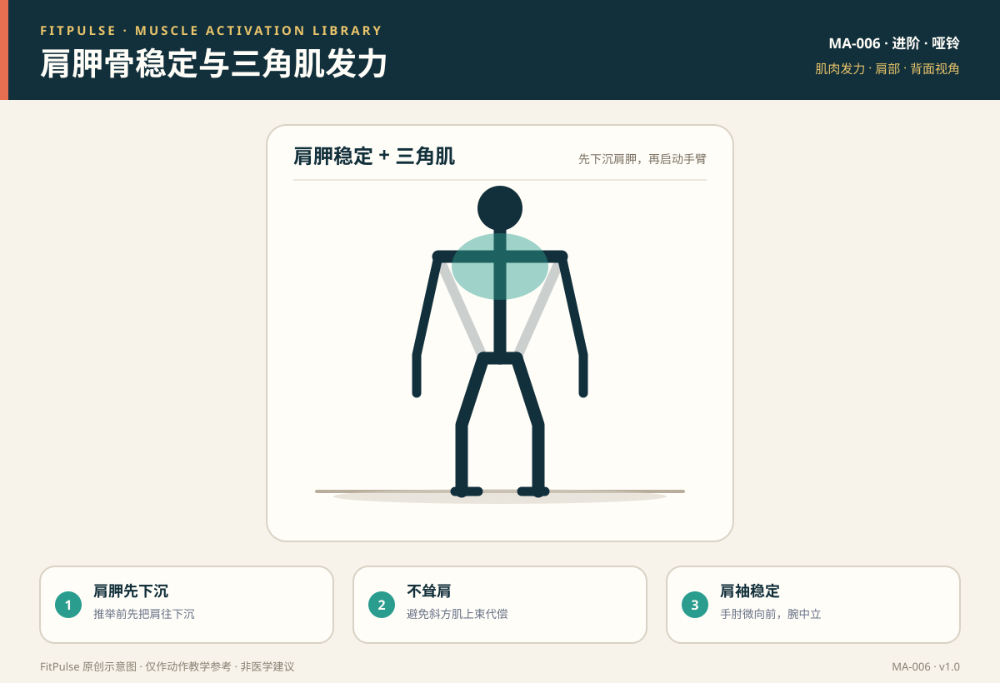

# 肩胛骨稳定与三角肌发力

*图示：背面视角，标注肩胛骨与三角肌发力位置；仅作教学示意。*

## 一句话要点

肩胛骨稳定是所有上肢推拉动作的基础：先把肩胛“后收下沉”（拉类）或“稳定上旋”（推举），再启动手臂；否则很容易耸肩，让斜方肌上束代偿、肩关节承压。

## 目标肌群与发力位置

- **稳定**：前锯肌（肩胛前伸/上旋）、中下斜方肌与菱形肌（后收下沉）、肩袖肌群（肩关节稳定）。
- **主要发力**：三角肌前束、中束、后束（肩屈曲、外展、伸展）。
- **发力位置**：推举时三角肌收缩感明显，肩胛稳定但不耸肩；划船时两肩胛相夹，肩颈放松。

## 为什么要先学发力感

肩胛骨像上肢的“地基”：地基不稳，推和拉的力量就无法有效传到手臂，还容易造成肩峰撞击、耸肩和颈部代偿。先练肩胛后收下沉、墙壁天使等控制动作，再进入负重推拉，能显著降低肩颈受伤风险。

## 激活准备（唤醒）

| 动作 | 做法 | 目标 |
|---|---|---|
| 肩胛后缩 | 坐姿，肩胛向后夹、向下沉，保持 2 秒 | 菱形肌、中下斜方肌 |
| 墙壁天使 | 背靠墙，手臂贴墙做“天使”划弧 | 肩胛控制与活动度 |
| 弹力带面拉 | 向面部方向拉弹力带，肘抬高 | 三角肌后束、肩袖、上背 |
| 前锯肌俯卧撑+ | 平板位，肩胛前伸后缩 | 前锯肌稳定 |

## 发力技巧与提示语

- **肩胛先下沉**：推举前先把肩胛往下“沉”，再启动手臂上推。
- **推举不耸肩**：哑铃推举过程中肩膀不往耳朵方向耸，颈部放松。
- **肩袖稳定**：手肘微向前、手腕中立，不在过度外展的位置硬推。
- **拉类先夹肩胛**：划船时先肩胛后收，再屈肘拉动。

## 常见的“发力错误感”（代偿信号）

| 错误感 | 说明 | 处理 |
|---|---|---|
| 耸肩、脖子酸 | 斜方肌上束代偿 | 减重，肩胛下沉，颈放松 |
| 肩前侧痛 | 肩胛前伸或过度外展 | 缩小幅度，保持肩胛稳定 |
| 翼状肩胛 | 前锯肌偏弱，肩胛内侧翘起 | 练前锯肌俯卧撑+、墙壁天使 |
| 手腕酸 | 手腕过度背伸 | 手腕中立，握持稳定 |

## 自测方法

做轻重量哑铃肩上推举 8–10 次，若三角肌有收紧感、肩胛稳定不耸肩、肩颈不痛，说明发力基本正确；若一上来就耸肩，减重并先做肩胛下沉练习。

## 关联动作

本条目服务于：俯卧撑（EX-004）、哑铃单臂俯身划船（EX-008）、哑铃肩上推举（EX-010）。

## 呼吸配合

推起/拉起（向心）时呼气，下放（离心）时吸气；核心轻收，避免憋气。

## 安全提示

- 肩关节有脱位史、肩袖损伤或明显撞击痛者，先咨询医生或康复师。
- 推举时出现肩部尖锐痛、手臂麻木或颈部放射痛，停止并就医。
- 本条目是教学信息，不构成医疗建议。

## 常见问题

**Q：推举时总想耸肩怎么办？**  
A：先减重，推举前主动把肩胛向下沉，保持颈部放松；可以对着镜子或录视频自查。若减重后仍耸肩，先练肩胛下沉和墙壁天使。

**Q：肩胛骨稳定为什么要单独练？**  
A：因为肩胛不稳时，推拉动作容易让斜方肌上束和肩关节代偿，导致耸肩、肩前侧痛。先建立“地基”，再练负重，事半功倍也更安全。

**Q：推举时手肘位置怎么放？**  
A：手肘微向前、位于手腕正下方或略前，保持前臂接近垂直地面；不要在肘关节过度外展的位置硬推，以减轻肩关节压力。

## 知识出处

- [S2] NSCA Essentials of Strength Training and Conditioning（推举动作技术与肩胛控制）
- [S3] ACE Exercise Library（肩上推举、面拉执行要点）
- [S6] Neumann, Kinesiology of the Musculoskeletal System（肩胛带与三角肌功能解剖）

完整书目与访问日期见 [SOURCES.md](../SOURCES.md)。

> 本条目由 FitPulse 团队整理，用于教学参考，不替代医生或线下教练的个体化评估。
