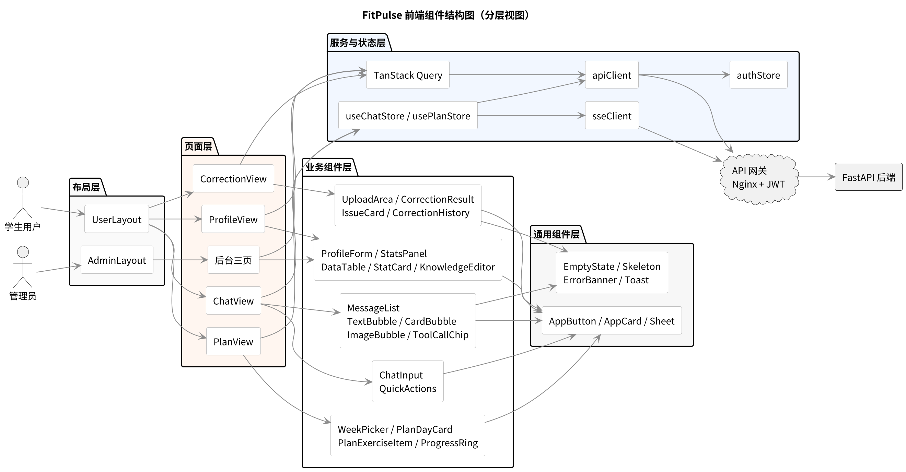
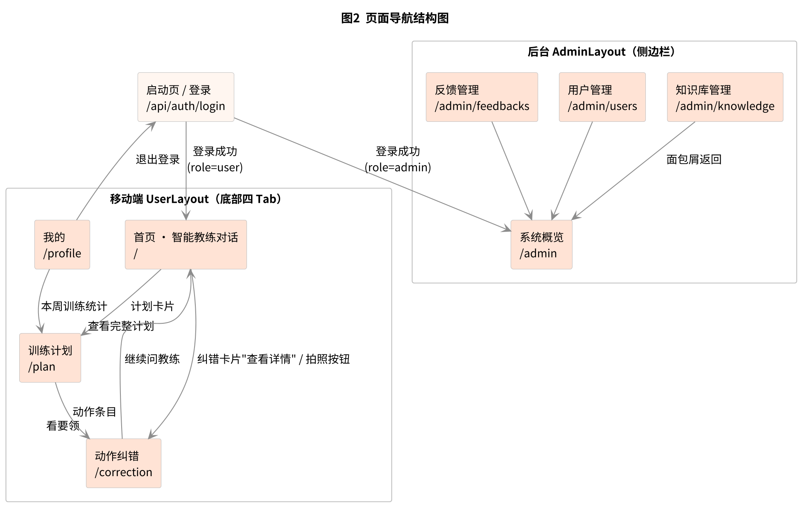
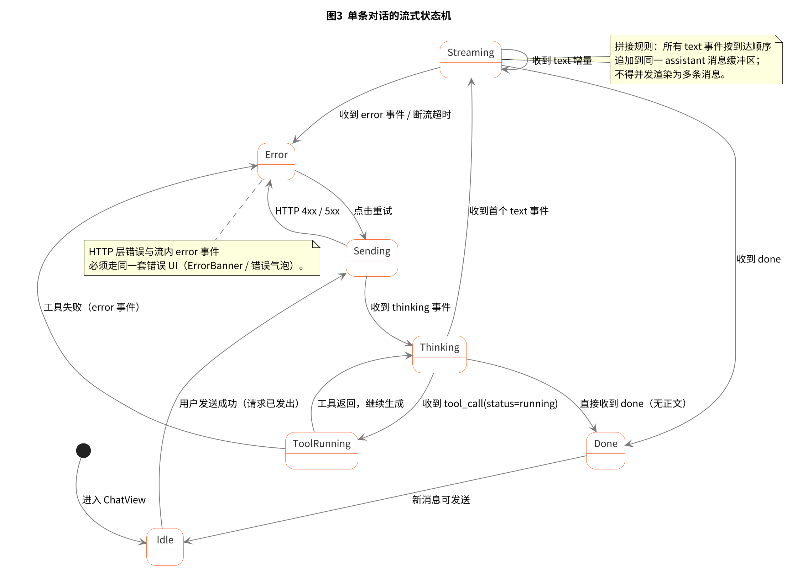
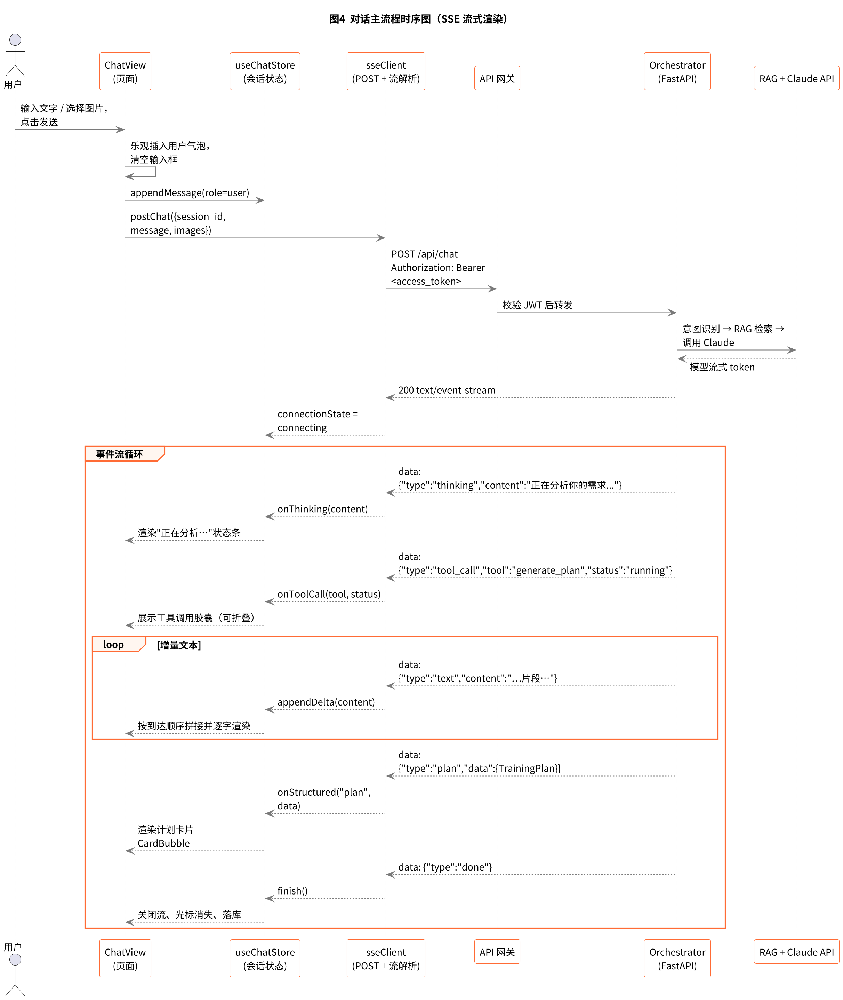

# FitPulse 前端设计说明

| 项目 | 内容 |
|---|---|
| 项目名称 | FitPulse 健身动作矫正 & 居家锻炼智能 Agent |
| 团队名称 | FitPulse |
| 文档版本 | v1.0（草案） |
| 编制日期 | 2026-11-09 |
| 编制人 | 张智轩（前端工程师，102401121） |
| 文档状态 | 评审中 |
| 参考规范 | GB/T 8567-2006《计算机软件文档编制规范》 |

---

## 文档修订记录

| 版本 | 日期 | 修改人 | 修改内容 |
|---|---|---|---|
| v1.0 | 2026-11-09 | 张智轩 | 初稿：页面结构、组件设计、状态管理、接口对接、前端 UML 四图 |

---

## 1. 引言

### 1.1 编写目的

本文档是《FitPulse 系统设计说明书》§3.2.5「前端模块」的展开与细化，面向第 9 周开始的前端编码工作，回答四个问题：

1. 前端由哪些页面、哪些组件构成，它们之间的层级与依赖关系如何；
2. 每个组件的职责、输入（Props）、内部状态与交互行为是什么；
3. 前端如何与后端接口对接，尤其是三条 SSE 流式接口的事件处理与异常分支；
4. 视觉、交互与工程结构上的统一约定。

本文档不重复需求分析、系统架构与数据库设计，相关内容以《FitPulse 需求分析文档》《FitPulse 系统设计说明书》《FitPulse 数据库设计说明书》《FitPulse API 接口设计说明书》为准。

### 1.2 范围与边界

本文档覆盖 `frontend/`（用户端，React 18）与 `admin/`（后台管理端）两个前端工程的界面层设计，包括：

- 页面与路由结构、布局骨架；
- 组件划分、组件 API、组件间通信；
- 前端状态管理、缓存策略、流式渲染状态机；
- 与 REST / SSE 接口的对接方式、错误处理与降级；
- 前端侧 UML（组件结构图、时序图、状态机、导航图）。

不覆盖：后端实现、模型提示词内容、知识库条目编写、部署脚本与运维配置。

### 1.3 术语与缩写

| 术语/缩写 | 定义 |
|---|---|
| SPA | Single Page Application，单页应用 |
| SSE | Server-Sent Events，服务器推送事件；本项目用于三条流式接口 |
| JWT | JSON Web Token，身份认证令牌，前端存 `access_token` 与 `refresh_token` |
| 设计令牌（Design Token） | 颜色、字号、间距、圆角等被抽象为变量的设计原子 |
| 气泡（Bubble） | 对话中承载单条消息的容器组件 |
| 乐观更新（Optimistic Update） | 请求发出前先更新界面，失败时回滚 |
| 三态 | 加载中（Loading）、空（Empty）、错误（Error）三种界面状态 |
| 骨架屏（Skeleton） | 内容加载前占位的灰块 |
| 首字延迟 | 从用户发送到收到模型第一个字符的时间 |

### 1.4 依据文档

- 《FitPulse 系统设计说明书》v1.0，§2 技术选型、§3.2 核心模块、§4.2 REST API、§5.1 数据结构
- 《FitPulse API 接口设计说明书》v0.1，§3 总体规范、§4 SSE 协议、§5 接口清单、§7 错误码
- 《FitPulse 数据库设计说明书》v1.0，§6 ORM 映射
- 《FitPulse 需求分析文档》v0.1，§3 功能需求
- `docs/原型/FitPulse_原型.html`，7 页高保真原型
- 《FitPulse 用户画像》

---

## 2. 前端总体设计

### 2.1 设计目标与约束

前端是用户与领域智能体之间唯一的接触面。FitPulse 的交互形态不是表单填写，而是「对话 + 结构化卡片 + 图片」，因此前端设计的核心矛盾是：**模型响应慢且不确定，而用户需要立即得到反馈。**

由此确定五条设计目标：

| 编号 | 目标 | 落地手段 |
|---|---|---|
| G1 | 首字之前不空等 | 发送即乐观插入用户气泡；`thinking` 事件渲染为状态条；输入框不禁用 |
| G2 | 流式内容可读 | `text` 事件按到达顺序拼接为同一条消息，逐字渲染，不闪烁、不重复 |
| G3 | 结构化结果可操作 | `plan` / `correction` 事件渲染为卡片，卡片内可直接打卡、看详情，不必回到对话 |
| G4 | 失败可恢复 | HTTP 错误与流内 `error` 走同一套错误 UI，保留已收到的内容，提供重试 |
| G5 | 移动优先 | 基准视口 390×844（iPhone 14），所有触控目标 ≥ 44×44 px |

硬约束来自后端与部署：

- 对话、计划生成、动作纠错三条接口为 `text/event-stream`，**必须**用 `fetch` + `ReadableStream` 解析，原生 `EventSource` 不支持 POST 与自定义 Header；
- 图片单文件 ≤ 10 MB，仅 JPG / PNG / WebP；
- access_token 有效期 2 小时，过期返回 40101，需静默刷新一次；
- Nginx 已关闭 `proxy_buffering`，前端无需额外配置。

### 2.2 技术栈与选型理由

| 层次 | 选型 | 理由 |
|---|---|---|
| 框架 | React 18 | 团队既有技术栈；`useTransition` 与并发渲染有利于长列表与流式更新 |
| 语言 | TypeScript 5 | 接口契约已由 `openapi.yaml` 定义，可由其生成类型，减少前后端字段漂移 |
| 构建 | Vite 5 | 冷启动快，HMR 稳定，`import.meta.env` 管理 Base URL |
| 样式 | TailwindCSS 3 | 与设计令牌一一映射；移动端原子类编写效率高，避免样式文件膨胀 |
| 路由 | react-router-dom 6 | 支持嵌套路由与布局路由，`UserLayout` / `AdminLayout` 天然对应 |
| 服务端状态 | TanStack Query 5 | 缓存、失效、重试、分页开箱即用；计划、历史、后台列表均适用 |
| 客户端状态 | Zustand 4 | 会话流式状态高频更新，Redux 样板过多；Zustand 可按选择器订阅，避免整树重渲染 |
| 图标 | lucide-react | 线性图标风格与原型一致，按需引入 |
| 测试 | Vitest + React Testing Library + Playwright | 组件单测 + 关键流程端到端 |

**不引入**：CSS-in-JS（与 Tailwind 重复）、Redux Toolkit（本项目无复杂跨模块状态）、UI 组件库（原型为定制视觉，引入后改造成本高于自研）。

### 2.3 分层结构

前端按「布局 → 页面 → 业务组件 → 通用组件 → 服务与状态」五层组织，上层只依赖下层，同层之间不直接通信。



各层职责：

| 层 | 职责 | 典型成员 | 是否可复用 |
|---|---|---|---|
| 布局层 | 承载持久化外壳（顶部标题、底部导航、侧边栏），OutLet 渲染子页面 | `UserLayout`、`AdminLayout` | 否 |
| 页面层 | 组装业务组件、发起数据请求、处理路由参数 | `ChatView`、`PlanView` 等 7 个 | 否 |
| 业务组件层 | 领域相关的可复用单元，含展示与局部交互 | `MessageList`、`PlanDayCard`、`IssueCard` | 页面间复用 |
| 通用组件层 | 与业务无关的原子组件与状态组件 | `AppButton`、`EmptyState`、`Skeleton` | 全站复用 |
| 服务与状态层 | 请求封装、流解析、令牌管理、全局状态 | `apiClient`、`sseClient`、`useChatStore` | 全站复用 |

约定：**页面层不直接写 `fetch`**，一律经服务层；**业务组件不直接调用接口**，数据由页面层通过 Props 注入，保证组件可在 Storybook 中脱离后端渲染。

### 2.4 工程结构

```
frontend/
├── public/
├── src/
│   ├── main.tsx                  # 应用入口，挂载 Router 与 QueryClient
│   ├── App.tsx                   # 路由表
│   ├── layouts/
│   │   ├── UserLayout.tsx        # 移动端外壳：状态栏 + Outlet + BottomNav
│   │   └── AdminLayout.tsx       # 后台外壳：侧边栏 + 顶栏 + Outlet
│   ├── pages/
│   │   ├── LoginView.tsx
│   │   ├── ChatView.tsx
│   │   ├── PlanView.tsx
│   │   ├── CorrectionView.tsx
│   │   ├── ProfileView.tsx
│   │   └── admin/
│   │       ├── DashboardView.tsx
│   │       ├── KnowledgeView.tsx
│   │       ├── UsersView.tsx
│   │       └── FeedbacksView.tsx
│   ├── components/
│   │   ├── chat/                 # MessageList、TextBubble、CardBubble…
│   │   ├── plan/                 # WeekPicker、PlanDayCard、PlanExerciseItem…
│   │   ├── correction/           # UploadArea、CorrectionResult、IssueCard…
│   │   ├── profile/              # ProfileForm、StatsPanel
│   │   ├── admin/                # DataTable、StatCard、KnowledgeEditor
│   │   └── common/               # AppButton、AppCard、Sheet、EmptyState…
│   ├── services/
│   │   ├── apiClient.ts          # fetch 封装、JWT 注入、401 刷新
│   │   ├── sseClient.ts          # POST + ReadableStream 解析
│   │   ├── endpoints/            # 按模块拆分的请求函数
│   │   └── queryKeys.ts
│   ├── stores/
│   │   ├── authStore.ts
│   │   └── chatStore.ts
│   ├── types/                    # 由 openapi.yaml 生成 + 手写扩展
│   ├── styles/
│   │   ├── tokens.css            # 设计令牌
│   │   └── index.css
│   └── utils/                    # 格式化、图片压缩、防抖
├── tailwind.config.ts
├── vite.config.ts
└── package.json
```

后台管理端 `admin/` 与用户端共用 `types/`、`services/`、`components/common/`，通过 monorepo 的 `packages/shared` 引入，避免接口层重复实现。

---

## 3. 页面结构与导航

### 3.1 路由表

| 路由 | 页面组件 | 布局 | 鉴权 | 主要接口 |
|---|---|---|---|---|
| `/login` | `LoginView` | 无布局 | 否 | `POST /api/auth/login` |
| `/` | `ChatView` | UserLayout | 需登录 | `POST /api/chat`、`POST /api/sessions`、`GET /api/sessions/{id}` |
| `/plan` | `PlanView` | UserLayout | 需登录 | `GET /api/plans/current`、`POST /api/plans/generate`、`PUT /api/plans/{plan_id}/days/{day_index}/exercises/{ex_idx}`、`GET /api/plans/history` |
| `/correction` | `CorrectionView` | UserLayout | 需登录 | `POST /api/correct`、`GET /api/correct/history`、`GET /api/correct/{id}`、`POST /api/uploads` |
| `/profile` | `ProfileView` | UserLayout | 需登录 | `GET/PUT /api/user/profile`、`GET /api/user/stats` |
| `/admin` | `DashboardView` | AdminLayout | 管理员 | `GET /api/admin/dashboard` |
| `/admin/knowledge` | `KnowledgeView` | AdminLayout | 管理员 | `GET/POST/PUT/DELETE /api/admin/knowledge` |
| `/admin/users` | `UsersView` | AdminLayout | 管理员 | `GET /api/admin/users` |
| `/admin/feedbacks` | `FeedbacksView` | AdminLayout | 管理员 | `GET /api/admin/feedbacks`、`PUT /api/admin/feedbacks/{id}` |

路由守卫规则：

- 无 `access_token` 且无 `refresh_token` → 重定向 `/login`，并记录 `redirect` 参数；
- `role !== 'admin'` 访问 `/admin/**` → 重定向 `/`，同时提示「无后台访问权限」；
- 页面级懒加载：`React.lazy` + `Suspense`，后台三页单独分包，不进入移动端首屏产物。

### 3.2 布局骨架

**UserLayout（移动端）**

```
┌──────────────────────────────┐
│ 状态栏（时间 / 信号，仅在原型中模拟） │  高度 24
├──────────────────────────────┤
│ 页面标题栏（可选，标题 + 右侧动作）    │  高度 48，吸顶
├──────────────────────────────┤
│                              │
│  <Outlet />  内容区           │  flex:1，独立滚动
│                              │
├──────────────────────────────┤
│ 教练 / 计划 / 我的   三 Tab 或四 Tab │  高度 56 + 安全区
└──────────────────────────────┘
```

- 内容区 `overflow-y: auto`，隐藏滚动条但保留滚动能力（原型同款）；
- 桌面浏览器下整体宽度限制 `max-width: 480px` 居中，两侧留白，不做平板适配的独立布局；
- 底部导航采用 `NavLink` 的 `isActive` 高亮，图标由 lucide-react 提供，激活态用品牌橙 `#FF6B35`。

**AdminLayout（后台）**

```
┌────────┬─────────────────────────────┐
│ Logo   │ 顶栏：面包屑 + 用户菜单          │
│        ├─────────────────────────────┤
│ 概览    │                             │
│ 知识库  │    <Outlet /> 表格 / 图表区     │
│ 用户    │                             │
│ 反馈    │                             │
└────────┴─────────────────────────────┘
```

侧边栏固定 200 px，`≥1280px` 展开文字，`1024–1280px` 收缩为图标并 hover 显示文字；后台不提供移动端布局，小屏访问时提示「请使用电脑访问后台」。

### 3.3 页面导航关系



导航遵循「对话为中心」的原则：四个 Tab 中首页是入口与回流点，计划页与纠错页均可通过对话中的结构化卡片跳入，处理完毕后可「继续问教练」回到首页并把上下文带回去。

### 3.4 页面结构说明

#### 3.4.1 对话首页 `/`（ChatView）

页面从上到下分为四个区域：

| 区域 | 内容 | 交互 |
|---|---|---|
| 顶部栏 | 「FitPulse 智能教练」标题 + 在线状态点 | 点击标题新建会话 |
| 消息区 | 消息列表，按时间正序，自动滚到底部 | 上滑加载历史；长按消息复制 |
| 快捷区 | 三个胶囊按钮：查动作 / 生成计划 / 动作纠错 | 点击后自动填入对应提示语，不直接发送 |
| 输入区 | 文本框（自增高，最多 4 行）+ 拍照 + 发送 | 空内容时发送禁用；回车发送，Shift+回车换行 |

首屏无消息时展示欢迎卡：教练头像、一句引导语、「先完善档案」按钮（跳 `/profile`）。该卡片在有第一条消息后不再显示。

消息区支持三类内容：纯文本气泡、结构化卡片（动作卡、计划卡、纠错卡）、图片气泡。工具调用过程以可折叠的胶囊形式附着在下一条助手消息上方，默认收起，点击展开显示工具名与耗时。

#### 3.4.2 训练计划页 `/plan`（PlanView）

| 区域 | 内容 | 交互 |
|---|---|---|
| 页头 | 标题「训练计划」+ 副标题「AI 为你定制」+ 「重新生成」按钮 | 重新生成需二次确认，走 SSE，进度以按钮内 loading 呈现 |
| 周切换 | 上周 / 本周 / 下周 | 切换触发 `GET /api/plans/history` 按 `week_number` 查询 |
| 完成度 | 本周完成率环形进度 | 打卡后动画过渡 |
| 日卡片列表 | 每个训练日一张卡片：星期 + 部位 + 预计时长 + 完成状态 | 默认展开今天，其余收起；点击展开 |
| 动作条目 | 动作名、组数×次数、组间休息、勾选框 | 勾选即打卡，乐观更新 |
| 空态 | 无计划时展示「还没有训练计划」+ 生成按钮 | 跳转对话页并预填「帮我生成一个训练计划」 |

#### 3.4.3 动作纠错页 `/correction`（CorrectionView）

| 区域 | 内容 | 交互 |
|---|---|---|
| 上传区 | 虚线框 + 相机图标 + 两个按钮：拍照 / 从相册选择 | 选中后本地预览，可删除重选 |
| 描述输入 | 可选文本框「补充说明（如：做的时候腰疼）」 | 限 200 字 |
| 分析中 | 上传区收缩为缩略图，下方显示分析进度（thinking → tool_call → text） | 可取消（abort） |
| 结果卡 | 整体评价 + 问题列表 + 安全提示 | 问题项可展开查看参考图 |
| 历史记录 | 最近 10 条纠错，显示动作名与日期 | 点击查看详情 |

结果卡的问题项按 `severity` 排序：severe（红）→ moderate（黄）→ mild（灰）。若返回 `safety_note`，在结果卡底部以警示条常驻展示，不可折叠。

#### 3.4.4 个人中心 `/profile`（ProfileView）

| 区域 | 内容 | 交互 |
|---|---|---|
| 头部 | 头像、昵称、一句话档案摘要（水平 · 目标 · 器械） | 点击头像上传新头像 |
| 统计区 | 四个数字：本周训练天数 / 累计次数 / 总时长 / 累计消耗 | 数字滚动动画 |
| 完成率 | 本周计划完成率环形图 | — |
| 列表 | 我的纠错记录、设置、关于 | 进入二级页 |
| 编辑资料 | 抽屉（Sheet）形式：昵称、水平、目标、器械多选、每周天数 | 保存走 `PUT /api/user/profile`，成功后 Toast |

#### 3.4.5 后台管理页 `/admin/*`

三页共用 `DataTable` 与 `StatCard`：

- **系统概览**：四个统计卡（总用户、今日活跃、本周纠错、知识库条目）+ 近 7 日 API 调用量折线图 + 待处理反馈列表；
- **知识库管理**：按模块（标准动作 / 肌肉发力 / 错误姿势）筛选的表格，列为动作名称、模块、目标肌群、操作；「新增条目」打开右侧抽屉表单，字段与 `KnowledgeChunk` 对齐；
- **用户管理**：用户表格，列为 ID、昵称、注册时间、训练天数、状态；支持按昵称搜索与按状态筛选，分页 10 条；
- **反馈管理**：反馈列表，状态（待处理 / 处理中 / 已解决）可一键流转。

表格统一约定：表头吸顶、空态插画、加载骨架行、分页器固定在底部、错误重试条置顶。

---

## 4. 设计规范

### 4.1 设计令牌

颜色沿用原型 `:root` 定义，全部映射为 Tailwind 主题扩展，禁止在组件中写死十六进制值。

| 令牌 | 值 | 用途 |
|---|---|---|
| `brand` | `#FF6B35` | 主按钮、激活态、强调数字 |
| `brand-soft` | `#FFF0E8` | 品牌色浅底、选中背景 |
| `ink` | `#2D2D2D` | 主文字、标题 |
| `ink-2` | `#666666` | 次要文字 |
| `ink-3` | `#888888` | 辅助说明、占位符 |
| `bg` | `#F5F5F5` | 页面底色 |
| `surface` | `#FFFFFF` | 卡片、气泡 |
| `line` | `#E8E8E8` | 分割线、描边 |
| `success` | `#4CAF50` | 完成态、打卡勾选 |
| `warning` | `#F5A623` | 中度问题 |
| `danger` | `#E5484D` | 严重问题、错误 |

字号与间距：

| 语义 | 字号 / 行高 | 用途 |
|---|---|---|
| display | 24 / 32 | 统计数字 |
| title | 17 / 24 | 页面标题、卡片标题 |
| body | 15 / 22 | 消息正文 |
| caption | 13 / 18 | 辅助说明 |
| micro | 11 / 16 | 标签、时间戳 |

间距使用 4 的倍数：`4 / 8 / 12 / 16 / 20 / 24 / 32`。圆角：卡片 16、气泡 18（靠发送方一侧 4）、按钮 12、胶囊 999。阴影仅用于浮层与底部导航：`0 -2px 12px rgba(0,0,0,0.06)`。

### 4.2 响应式断点

| 断点 | 范围 | 策略 |
|---|---|---|
| 移动优先 | < 640 px | 默认样式，全宽，底部导航 |
| 大屏手机 / 小屏 | 640–1024 px | 容器居中，最大 480 px，背景 `#E8E8E8` 模拟机身 |
| 后台 | ≥ 1024 px | 切换 AdminLayout，侧边栏 200 px |
| 宽屏后台 | ≥ 1280 px | 表格列全展示，图表双列 |

### 4.3 状态与反馈规范

每个需要异步数据的区块都必须实现四态，缺一不可：

| 状态 | 表现 | 示例 |
|---|---|---|
| Loading | 骨架屏，形状与最终内容一致；超过 3 s 追加「正在加载…」文案 | 计划页日卡片骨架 |
| Empty | 插画 + 一句解释 + 一个主行动按钮 | 「还没有训练计划」+ 生成 |
| Error | 错误条 + 重试按钮，保留页面其他可用区域 | 「网络开小差了」+ 重试 |
| Success | 轻量 Toast（2 s 自动消失）或就地状态变化 | 打卡勾选变绿 |

流式内容额外有「生成中」状态：末尾跟随一个闪烁光标，`aria-live="polite"`，`done` 后光标消失。

### 4.4 文案与无障碍

- 按钮文案用动词开头：「生成计划」「重新分析」「保存资料」；
- 错误提示说清「发生了什么 + 怎么办」，不暴露技术细节（不出现 `50001` 这类码）；
- 触控目标 ≥ 44×44 px，图标按钮需有 `aria-label`；
- 正文与背景对比度 ≥ 4.5:1，`ink-3` 仅用于 13 px 以上辅助文字；
- 尊重 `prefers-reduced-motion`：关闭滚动动画与数字滚动；
- 图片必须提供 `alt`，动作图用动作名，用户上传图用「你的动作照片」。

---

## 5. 组件设计

### 5.1 组件分层与命名

组件按 `components/<domain>/<PascalCase>.tsx` 组织，域名与页面模块一致（`chat` / `plan` / `correction` / `profile` / `admin`）。通用组件置于 `components/common/`，以 `App` 前缀区分，避免与业务组件混淆。

组件分三类：

- **展示型**（Dumb）：只接收 Props，无内部请求，如 `TextBubble`、`IssueCard`；
- **容器型**（Smart）：负责取数、订阅 store、处理副作用，如 `MessageList`、`PlanDayCard`；
- **布局型**：只负责位置与间距，如 `AppCard`、`Sheet`。

### 5.2 组件清单

| 组件 | 层 | 类型 | 职责 | 关键 Props | 内部状态 |
|---|---|---|---|---|---|
| `ChatView` | 页面 | 容器 | 组装对话页、绑定快捷键、控制滚动 | — | 无（读 store） |
| `MessageList` | 业务 | 容器 | 渲染消息序列、自动滚动、历史加载 | `messages`、`streamingId`、`onRetry` | `atBottom` |
| `TextBubble` | 业务 | 展示 | 纯文本消息，Markdown 子集渲染 | `role`、`content`、`status` | — |
| `CardBubble` | 业务 | 展示 | 承载动作卡 / 计划卡 / 纠错卡 | `type`、`payload`、`onAction` | `collapsed` |
| `ImageBubble` | 业务 | 展示 | 用户上传图，点击全屏预览 | `url`、`alt` | — |
| `ToolCallChip` | 业务 | 展示 | 工具调用状态胶囊 | `tool`、`status`、`elapsed` | `expanded` |
| `QuickActions` | 业务 | 展示 | 三个预置提问 | `onPick(text)` | — |
| `ChatInput` | 业务 | 容器 | 输入、图片选择、发送、字数与大小校验 | `disabled`、`onSend`、`onPickImage` | `text`、`images` |
| `PlanView` | 页面 | 容器 | 计划页取数与状态编排 | — | `weekOffset` |
| `WeekPicker` | 业务 | 展示 | 上周 / 本周 / 下周 | `value`、`onChange`、`range` | — |
| `PlanDayCard` | 业务 | 容器 | 单个训练日，展开/收起与打卡 | `day`、`defaultOpen`、`onToggleDone` | `open` |
| `PlanExerciseItem` | 业务 | 展示 | 单个动作行与勾选 | `exercise`、`onToggle`、`pending` | — |
| `ProgressRing` | 通用 | 展示 | 环形进度 | `value`、`size`、`label` | — |
| `CorrectionView` | 页面 | 容器 | 纠错页取数与上传流程 | — | `file`、`stage` |
| `UploadArea` | 业务 | 展示 | 虚线框、拍照与相册入口 | `onSelect`、`preview`、`disabled` | — |
| `CorrectionResult` | 业务 | 展示 | 整体评价 + 问题列表 + 安全提示 | `report` | — |
| `IssueCard` | 业务 | 展示 | 单个问题：部位、描述、纠正、参考图 | `issue`、`onPreview` | `open` |
| `CorrectionHistory` | 业务 | 容器 | 历史记录列表与分页 | `items`、`onOpen`、`loading` | — |
| `ProfileForm` | 业务 | 容器 | 档案编辑表单与校验 | `profile`、`onSave` | `draft`、`errors` |
| `StatsPanel` | 业务 | 展示 | 四个统计数字 | `stats` | — |
| `DataTable` | 通用 | 容器 | 后台表格：排序、分页、空态、错误 | `columns`、`rows`、`total`、`onPage` | `sort` |
| `StatCard` | 通用 | 展示 | 后台统计卡 | `label`、`value`、`delta` | — |
| `KnowledgeEditor` | 业务 | 容器 | 知识条目抽屉表单 | `initial`、`onSubmit` | `form` |
| `AppButton` | 通用 | 展示 | 按钮，含 loading / disabled 态 | `variant`、`size`、`loading` | — |
| `AppCard` | 通用 | 布局 | 白底圆角卡片 | `padding`、`onClick` | — |
| `Sheet` | 通用 | 布局 | 底部抽屉 / 右侧抽屉 | `open`、`onClose`、`side` | — |
| `EmptyState` | 通用 | 展示 | 空态插画 + 文案 + 行动 | `title`、`desc`、`action` | — |
| `ErrorBanner` | 通用 | 展示 | 错误条 + 重试 | `message`、`onRetry` | — |
| `Skeleton` | 通用 | 展示 | 骨架块 | `w`、`h`、`rounded` | — |
| `Toast` | 通用 | 展示 | 全局轻提示 | `type`、`message` | 由 store 控制 |

### 5.3 关键组件详细设计

#### 5.3.1 ChatView 与流式渲染

`ChatView` 本身不持有消息状态，全部读取 `useChatStore`：

```ts
const messages = useChatStore(s => s.messages);
const stream = useChatStore(s => s.stream);   // { state, messageId, error }
const send = useChatStore(s => s.send);
```

发送流程：

1. `ChatInput` 触发 `onSend(text, files)`；
2. store 立即 push 一条 `role: 'user'` 消息，并 push 一条空的 `role: 'assistant'` 消息作为流缓冲区，记为 `streamingId`；
3. `sseClient.postChat()` 建立连接；
4. 每个 `text` 事件把增量追加到 `streamingId` 对应消息的 `content`；
5. `done` 时把该消息标记为 `complete`，`streamingId` 置空；
6. 若中途失败，保留已收到的部分，标记 `status: 'error'` 并在气泡下方渲染重试条。

自动滚动策略：只有当用户当前距底部 < 80 px 时才跟随滚动；用户主动上滑后停止自动滚动，并显示「回到最新」悬浮按钮。此策略避免阅读历史时被流式输出强行拉回底部。

#### 5.3.2 三类气泡

```ts
interface TextBubbleProps {
  role: 'user' | 'assistant';
  content: string;
  status?: 'streaming' | 'complete' | 'error';
}
```

- `TextBubble` 只渲染 Markdown 的受限子集：粗体、列表、行内代码、段落。不渲染 HTML、不渲染外链图片，防止模型输出注入。
- `CardBubble` 依据 `type` 分派到 `ExerciseCard` / `PlanCard` / `CorrectionCard`，卡片底部提供动作按钮（「查看完整计划」「查看详情」「继续问教练」），点击后由页面层决定是路由跳转还是追加提问。
- `ImageBubble` 显示 160×160 缩略图，点击打开全屏 `ImageViewer`，支持双指缩放。

#### 5.3.3 ChatInput

- 自增高：`rows=1` 起，随内容增长至 4 行后内部滚动；
- 发送条件：`text.trim().length > 0 || images.length > 0`，且 `!disabled`；
- 图片：`<input type="file" accept="image/jpeg,image/png,image/webp" multiple>`，选后本地压缩至长边 1600 px、质量 0.8，超过 10 MB 直接拒绝并 Toast；
- 上传时机：发送时统一上传，拿到 `image_url` 后再发起 `/api/chat`，避免图片未就绪就进入模型；
- 键盘：桌面端 Enter 发送、Shift+Enter 换行；移动端靠发送按钮，Enter 换行。

#### 5.3.4 计划相关组件

`PlanDayCard` 是页面中唯一的打卡容器：

```ts
interface PlanDayCardProps {
  day: PlanDay;
  defaultOpen: boolean;
  onToggleDone: (dayIndex: number, exerciseIndex: number, done: boolean) => void;
  pendingKeys: Set<string>;   // 正在提交的条目，用于显示局部 loading
}
```

打卡采用乐观更新：点击即时置为完成并更新 `ProgressRing`；请求失败则回滚并 Toast「打卡失败，请重试」。多个条目可并发提交，`pendingKeys` 保证单条独立 loading，不阻塞整张卡片。

#### 5.3.5 纠错相关组件

`UploadArea` 与 `CorrectionResult` 之间由 `CorrectionView` 的 `stage` 串联：

```
idle → previewing → uploading → analyzing(thinking/tool_call/text) → result | error
```

`analyzing` 阶段保留缩略图占位，下方以文字状态推进，而不是全屏 loading，让用户知道「AI 正在看图」。`abort` 时保留原图，允许重新提交。

`IssueCard` 的颜色严格对应 `severity`：`severe` 红色左边框、`moderate` 橙色、`mild` 灰色。参考图以 4:3 缩略图展示，缺省时用动作示意图占位。

#### 5.3.6 个人中心与后台

`ProfileForm` 的器械为多选标签，选项固定为 `['自重', '瑜伽垫', '弹力带', '哑铃', '壶铃', '单杠']`，与知识库 `equipment_needed` 字段取值保持一致；每周天数用 1–7 的步进器。保存前做本地校验，仅提交变更字段（`PATCH` 语义的 `PUT`）。

后台 `DataTable` 为受控组件，分页与排序状态由页面层持有，便于与服务端查询参数同步；列定义使用 `columns: { key, title, width, render?, sortable? }[]`。

### 5.4 通用组件 API 约定

所有通用组件遵循：

- 受控优先：有交互状态的组件必须支持 `value` + `onChange`，内部状态仅作为不受控时的兜底；
- 透传 `className`，合并顺序为「组件基础类 → 调用方类」，保证可覆盖；
- `loading` / `disabled` 二态在视觉与可访问性上同时生效（`aria-busy`、`disabled`）；
- 不抛出运行时错误，异常输入渲染为空态。

---

## 6. 状态管理与数据流

### 6.1 三类状态的划分

| 类别 | 存放位置 | 生命周期 | 例子 |
|---|---|---|---|
| 服务端状态 | TanStack Query 缓存 | 由 `staleTime` 与失效策略控制 | 用户档案、当前计划、纠错历史、后台列表 |
| 全局客户端状态 | Zustand store | 与应用同生命周期 | 令牌、当前用户、会话消息、流式状态 |
| 局部 UI 状态 | `useState` | 组件卸载即销毁 | 抽屉开关、展开/收起、表单草稿 |

划分原则：**能被多个页面读到的、且不属于服务端的**放 Zustand；**来自后端的**一律交给 Query，不复制进 store，避免双向同步。

### 6.2 useChatStore 结构

```ts
interface ChatState {
  sessionId: string | null;
  messages: ChatMessage[];
  stream: {
    state: StreamState;
    streamingId: string | null;
    tool: { name: string; status: 'running' | 'done' } | null;
    error: { code: number; message: string } | null;
  };
  send: (text: string, images: string[]) => Promise<void>;
  retry: () => Promise<void>;
  abort: () => void;
  reset: () => void;
}
```

`messages` 与 `stream` 分开存放，流式增量只更新 `stream` 与目标消息，配合 `useChatStore(selector)` 让 `QuickActions` 等静态组件不参与重渲染。

Query 键约定：

```ts
export const queryKeys = {
  profile: ['user', 'profile'] as const,
  stats: ['user', 'stats'] as const,
  currentPlan: ['plans', 'current'] as const,
  planHistory: (page: number) => ['plans', 'history', page] as const,
  corrections: (page: number) => ['corrections', page] as const,
  exercises: (q: string) => ['exercises', q] as const,
  admin: {
    dashboard: ['admin', 'dashboard'] as const,
    knowledge: (module: string, page: number) => ['admin', 'knowledge', module, page] as const,
    users: (page: number) => ['admin', 'users', page] as const,
    feedbacks: (status: string, page: number) => ['admin', 'feedbacks', status, page] as const,
  },
};
```

### 6.3 流式渲染状态机



状态迁移由 `sseClient` 解析出的事件驱动，规则如下：

| 当前状态 | 事件 | 迁移 | 界面表现 |
|---|---|---|---|
| Idle | 用户点击发送 | Sending | 用户气泡已插入，助手气泡显示三点动画 |
| Sending | `thinking` | Thinking | 状态条「正在分析你的需求…」 |
| Thinking | `tool_call(running)` | ToolRunning | 胶囊「正在生成计划…」 |
| ToolRunning | 工具完成后的 `text` | Streaming | 开始逐字输出 |
| Thinking | `text` | Streaming | 直接输出 |
| Streaming | `text` | Streaming | 追加片段 |
| 任意 | `done` | Done | 光标消失，消息标记完成 |
| 任意 | `error` / 断流 | Error | 错误条 + 重试，保留已收内容 |
| Error | 点击重试 | Sending | 复用同参数重发 |

关键约束：**所有 `text` 片段必须拼接到同一条消息**；不得因为渲染性能把片段拆成多条气泡。拼接在 store 内完成，组件只负责渲染最终字符串。

### 6.4 计划打卡的乐观更新

```ts
const mutation = useMutation({
  mutationFn: markExerciseDone,
  onMutate: async (vars) => {
    await queryClient.cancelQueries({ queryKey: queryKeys.currentPlan });
    const prev = queryClient.getQueryData<TrainingPlan>(queryKeys.currentPlan);
    queryClient.setQueryData(queryKeys.currentPlan, (old: TrainingPlan) =>
      patchExercise(old, vars, true));
    return { prev };
  },
  onError: (_e, _v, ctx) => {
    queryClient.setQueryData(queryKeys.currentPlan, ctx?.prev);
    toast.error('打卡失败，请重试');
  },
  onSettled: () => queryClient.invalidateQueries({ queryKey: queryKeys.currentPlan }),
});
```

### 6.5 令牌与登录态

`authStore` 管理 `accessToken`、`refreshToken`、`user`、`role`。持久化策略：`accessToken` 存内存 + `localStorage`（便于刷新页面后恢复），`refreshToken` 仅存 `localStorage`。登出时清空 Query 缓存并跳转 `/login`。

---

## 7. 接口对接设计

### 7.1 端点与页面映射

| 页面 | 端点 | 方式 | 是否流式 | 触发时机 |
|---|---|---|---|---|
| 对话 | `/api/chat` | POST | 是 | 用户发送 |
| 对话 | `/api/sessions/{id}` | GET | 否 | 进入页面恢复历史 |
| 计划 | `/api/plans/current` | GET | 否 | 页面挂载 |
| 计划 | `/api/plans/generate` | POST | 是 | 点击「重新生成」 |
| 计划 | `/api/plans/{plan_id}/days/{day_index}/exercises/{ex_idx}` | PUT | 否 | 勾选动作 |
| 计划 | `/api/plans/history` | GET | 否 | 切换周 |
| 纠错 | `/api/correct` | POST | 是 | 点击「开始分析」 |
| 纠错 | `/api/correct/history` | GET | 否 | 页面挂载 / 分页 |
| 纠错 | `/api/correct/{id}` | GET | 否 | 点击历史条目 |
| 上传 | `/api/uploads` | POST | 否 | 发送前上传图片 |
| 我的 | `/api/user/profile` | GET/PUT | 否 | 页面挂载 / 保存 |
| 我的 | `/api/user/stats` | GET | 否 | 页面挂载 |
| 后台 | `/api/admin/*` | GET/POST/PUT/DELETE | 否 | 各页挂载与操作 |

### 7.2 SSE 客户端

三条流式接口共用同一解析器，差异仅在请求体：

```ts
export type StreamEvent =
  | { type: 'thinking'; content: string }
  | { type: 'tool_call'; tool: string; status: 'running' | 'done' }
  | { type: 'text'; content: string }
  | { type: 'plan'; data: TrainingPlan }
  | { type: 'correction'; data: CorrectionReport }
  | { type: 'done' }
  | { type: 'error'; error: { code: number; message: string } };

export async function streamRequest(
  path: string,
  init: RequestInit,
  onEvent: (e: StreamEvent) => void,
  signal?: AbortSignal,
) {
  const res = await fetch(path, { ...init, signal });
  if (!res.ok) {
    const body = await res.json().catch(() => null);
    throw new ApiError(res.status, body?.code ?? res.status, body?.message ?? '请求失败');
  }
  const reader = res.body!.getReader();
  const decoder = new TextDecoder();
  let buffer = '';

  while (true) {
    const { value, done } = await reader.read();
    if (done) break;
    buffer += decoder.decode(value, { stream: true });

    // 事件以空行分隔；最后一段可能不完整，留在 buffer 中
    const chunks = buffer.split('\n\n');
    buffer = chunks.pop() ?? '';
    for (const chunk of chunks) {
      const line = chunk.trim();
      if (!line.startsWith('data:')) continue;   // 忽略 ": ping" 保活注释
      onEvent(JSON.parse(line.slice(5).trim()));
    }
  }
}
```

工程上补三点：

1. **90 秒无数据**判定为断流（`AbortController` + 定时器重置），避免移动网络切换后连接悬挂；
2. `error` 事件到达后主动 `abort()`，不再等待 `done`；
3. 组件卸载或用户取消时调用 `abort()`，防止对已卸载组件 setState。

### 7.3 鉴权与令牌刷新

`apiClient` 统一注入 `Authorization: Bearer <access_token>`。收到 401 / 40101 时：

1. 若当前没有刷新中的请求，调用 `POST /api/auth/refresh`；
2. 刷新成功 → 更新令牌 → 重放**原请求**；
3. 刷新失败或原请求重放后仍 401 → 清空登录态，跳转 `/login?redirect=<当前路径>`。

并发保护：多个请求同时 401 时，只发起一次刷新，其余请求挂起等待同一个 Promise，避免刷新风暴。

### 7.4 错误码与文案映射

| 业务码 | HTTP | 前端文案 | 动作 |
|---|---|---|---|
| 40001 | 400 | 「填写的信息有误，请检查后重试」 | 高亮首个错误字段 |
| 40100 | 401 | 「登录已过期，请重新登录」 | 跳转登录 |
| 40101 | 401 | —（静默） | 自动刷新一次 |
| 40300 | 403 | 「你没有访问该功能的权限」 | 隐藏入口，回首页 |
| 40400 | 404 | 「内容不存在或已被删除」 | 空态页 |
| 42900 | 429 | 「请求太频繁，请 N 秒后再试」 | 按 `Retry-After` 倒计时禁用按钮 |
| 50000 | 500 | 「服务开小差了，请稍后重试」 | 显示重试 |
| 50001 | 503 | 「智能教练暂时繁忙，请稍后再问」 | 显示重试，保留输入 |
| 50002 | 503 | 「知识库暂时不可用，请稍后再试」 | 显示重试 |
| 50003 | 400/413 | 「图片格式不支持或超过 10MB」 | 提示重新选择 |
| 流内 error | 200 | 同上，按 code 映射 | 消息气泡下方错误条 |

HTTP 层错误与流内 `error` 共用同一张映射表，保证用户在不同失败路径下看到一致的措辞。

### 7.5 上传约定

- 客户端先压缩（长边 1600 px、JPEG 质量 0.8），再校验 ≤ 10 MB；
- `multipart/form-data`，字段名 `file`，**不手动设置** `Content-Type`，由浏览器补 boundary；
- 上传返回 `{ url }`，对话与纠错接口均传 URL 而非二进制；
- 预览使用 `URL.createObjectURL`，组件卸载时 `revokeObjectURL` 释放内存。

### 7.6 对话主流程时序

图4 只画正常路径。失败分支（HTTP 4xx/5xx、流内 `error`、断流超时、401 刷新重放）不重复绘制，其状态迁移见 §6.3 图3，提示文案与处理动作见 §7.4。



---

## 8. 性能与工程化

### 8.1 加载策略

- 路由级懒加载，`/admin/**` 独立 chunk，移动端首屏不加载后台代码；
- 首屏预加载 `ChatView` 与字体，其余页面进入时加载；
- 图片 `loading="lazy"` + 固定宽高占位，避免布局抖动；
- 消息列表超过 100 条时启用虚拟滚动（`@tanstack/react-virtual`），仅渲染视口内消息。

### 8.2 渲染优化

- 气泡组件 `React.memo`，比较 `id` 与 `content` 长度，流式阶段只有末尾一条消息更新；
- `MessageList` 的 store 选择器只取 `messages` 与 `streamingId`，避免 `stream.state` 变化引起整列表重渲染；
- Markdown 渲染结果按 `content` 缓存（LRU 50），流式过程中不缓存中间态；
- 图表（后台折线图）按需引入，使用 `React.lazy` 包裹。

### 8.3 质量保障

- 组件单测：通用组件与纯展示组件的 Props 分支覆盖；
- 集成测试：`sseClient` 用 mock `ReadableStream` 覆盖正常流、流内 error、断流、401 重放四种场景；
- 端到端：Playwright 覆盖「发送消息 → 流式渲染 → 卡片跳转」「上传图片 → 纠错结果」「打卡 → 进度更新」三条主链路；
- 类型：`openapi.yaml` 生成类型，CI 中执行 `tsc --noEmit` 与契约比对。

---

## 9. 与后端、产品的待确认事项

| 编号 | 问题 | 影响 | 前端暂定方案 |
|---|---|---|---|
| Q1 | 账号体系用学号、邮箱还是手机号？ | 登录页表单与校验规则 | 按 `username` + `password` 实现，字段可配置 |
| Q2 | 会话是否支持多会话列表？ | 首页是否需要会话抽屉 | 暂按单会话实现，store 预留 `sessions` 字段 |
| Q3 | `plan` 事件是否可能在 `done` 之后到达？ | 事件处理顺序 | 按「`plan` 先于 `done`」实现，异常时兜底缓存 |
| Q4 | 纠错历史是否需要删除能力？ | 历史列表交互 | 暂不提供删除 |
| Q5 | 后台是否需要操作审计日志？ | 概览页模块 | 暂不设计 |
| Q6 | 动作图使用 MinIO 直链还是 CDN？ | 图片加载策略与缓存头 | 按直链实现，预留 `imgBase` 配置 |
| Q7 | 是否需要离线/弱网降级提示？ | 全局网络状态组件 | 仅做请求级超时提示 |

---

## 10. 附：交付物清单

| 文件 | 说明 |
|---|---|
| `docs/FitPulse_前端设计说明.md` | 本文档 |
| `docs/images/frontend/01-component.png` | 图1 前端组件结构图 |
| `docs/images/frontend/02-navigation.png` | 图2 页面导航结构图 |
| `docs/images/frontend/03-state.png` | 图3 流式状态机 |
| `docs/images/frontend/04-sequence.png` | 图4 对话主流程时序图 |
| `docs/index.html` | 原型在线展示页（GitHub Pages 入口） |
